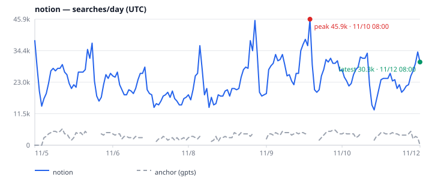
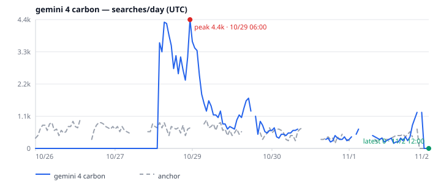

<p align="center">
  <picture>
    <source media="(prefers-color-scheme: dark)" srcset="docs/assets/logo-dark.svg">
    <source media="(prefers-color-scheme: light)" srcset="docs/assets/logo-light.svg">
    
  </picture>
</p>

<p align="center"><b>Search-interest signals for AI agents. One call in, stable JSON out.</b></p>

<p align="center">English | <a href="README.zh-CN.md">简体中文</a></p>

<p align="center"><a href="https://www.npmjs.com/package/google-trends-for-agent"></a> <a href="https://apify.com/meka.im/google-trends-for-agent"></a> <a href="LICENSE"></a> <a href="https://nodejs.org">= 20"></a>  </p>

<p align="center"><a href="https://apify.com/meka.im/google-trends-for-agent"><picture><source media="(prefers-color-scheme: dark)" srcset="docs/assets/store-button-en-dark.png"></picture></a></p>

> [!WARNING]
> **Unofficial. Not affiliated with or endorsed by Google.** This project calls undocumented public Google Trends web endpoints that can change or fail without notice, and use may conflict with Google's Terms of Service. Use it for light, interactive analysis, not bulk scraping or an SLA.

`google-trends-for-agent` gives agents and humans a predictable way to ask how search interest is changing: a stable JSON envelope, calibrated searches/day estimates, charts, and explicit error codes instead of invented numbers.

<p align="center">
  
</p>
<p align="center"><sub>Real snapshot output, trimmed. The full envelope also includes the series, primary and 7-day traffic blocks, related-query context, warnings, and metadata.</sub></p>

## Choose your client guide

**AI agents: start at the [Client Setup Router](docs/clients.md) and open the guide for your exact host before installing or calling tools.**

- [DeepSeek Harness (dsh)](docs/clients/dsh.md) · [GrokBot](docs/clients/grokbot.md) · [Muse](docs/clients/muse.md) · [Dots & Web Agents](docs/clients/dots.md)
- [Claude Code & Desktop](docs/clients/claude.md) · [OpenAI Codex](docs/clients/codex.md) · [Cursor / VS Code / Windsurf / Cline](docs/clients/cursor-vscode.md) · [OpenClaw & CLI](docs/clients/openclaw.md)

**Muse, GrokBot and Dots: use Apify on demand by default**, with either the public
Actor or your own deployment. Use the managed remote MCP gateway where supported,
or the client's authenticated Apify connector/API. Local access remains available
for development and explicit direct-use setups.

| Route | Where it runs | Execution |
| --- | --- | --- |
| Public Actor | Your Apify account | One run per query; exits when done, no deployment |
| My own Actor | Your Apify account | Deploy once, then run on demand |
| Local | This machine | CLI, stdio MCP, or native dsh tools |

<a id="deploy-it-yourself"></a>

### Deploy it yourself

Fork the repository and build it with Link Git repository in Apify Console, or run `apify push`. Keep Server / Standby disabled. In dsh, select My own Actor, sign in with Apify, and select the built Actor.

For an existing deployment from official main, use **Update selected Actor** in dsh. After the build finishes, **Test connection** shows keyword access and the actual Actor/plugin versions separately. Custom or pinned source is updated in Apify Console. See the [release and acceptance checklist](docs/releasing.md).

### Remote MCP

For Muse, GrokBot and Dots with remote MCP support, use Apify's hosted gateway
and complete OAuth in the client:

```json
{
  "mcpServers": {
    "google-trends": {
      "url": "https://mcp.apify.com?tools=meka.im/google-trends-for-agent"
    }
  }
}
```

For your own deployment, replace `meka.im/google-trends-for-agent` in `tools=`
with your account's `<username>/<actor-name>`. The account must have access to it.

The gateway exposes this project as an Actor tool and supplies Dataset, key-value-store, and abort tools. It starts a one-off run; it does not promise the four direct `trends_*` names. Local MCP and the native dsh plugin provide the four `trends_*` tools. For ordinary `tool` / `terms` Actor input, read the results using the returned Dataset id.

Apify's `full_api_access` OAuth scope grants account-wide API access. Clients without MCP OAuth can configure a Bearer header through their credential storage. See the [Actor reference](.actor/README.md) and [Actor costs](docs/reference.md#actor-costs).

## Install & quick start

The CLI and MCP server are published on npm as [`google-trends-for-agent`](https://www.npmjs.com/package/google-trends-for-agent) and require Node.js 20+. Run immediately with `npx`:

```sh
npx -y -p google-trends-for-agent gtfa snapshot Sora --geo US --json --pretty
```

For frequent use, install globally from npm:

```sh
npm install -g google-trends-for-agent
```

Or build from source if you prefer a local git checkout:

```sh
git clone https://github.com/meka-im/google-trends-for-agent.git
cd google-trends-for-agent
npm ci
npm install -g "$(npm pack | tail -1)"
```

The source checkout tracks the repository's default `main` branch. If your review process requires an immutable source revision, pin a published npm version or git commit rather than relying on a moving branch.

The published tarball bundles the audited `apify` dependency tree so a consumer install does not re-resolve older vulnerable Apify transitives. Root npm `overrides` do not propagate into consumers, so this bundle is part of the consumer protection. The root also applies an explicit `@crawlee/core` → `minimatch` `^11.0.1` security override (lock: `11.0.8`); Crawlee declares `^9`, so consumer `npm ls` may show a range warning even though the explicit override is intentional. Audits cover both the root tree and a clean install of the packed artifact. Bundling materially increases package size.

The CLI is `gtfa`; `gtfa-mcp` runs the local MCP server. Both default to `local` egress (this machine's network) and also support Apify on-demand cloud egress (`--egress actor-public` or `--egress actor-own --actor <id>`, or `GTFA_EGRESS` / `GTFA_APIFY_ACTOR` with `APIFY_TOKEN`), giving direct access to the four `trends_*` tools through Apify's residential proxy. For managed remote MCP without a local Node process, Muse, GrokBot and Dots should start with the [Apify setup](docs/clients.md):

```json
{
  "mcpServers": {
    "google-trends": {
      "command": "npx",
      "args": ["-y", "-p", "google-trends-for-agent", "gtfa-mcp"]
    }
  }
}
```

To route local stdio MCP or CLI calls through Apify's public Actor with `APIFY_TOKEN` in the client's secure environment:

```json
{
  "mcpServers": {
    "google-trends": {
      "command": "npx",
      "args": ["-y", "-p", "google-trends-for-agent", "gtfa-mcp", "--egress", "actor-public"],
      "env": { "APIFY_TOKEN": "<your-apify-token>" }
    }
  }
}
```

After a global install (`npm install -g google-trends-for-agent`), use this config (or an absolute path to `gtfa-mcp`) directly without invoking `npx` on every start:

```json
{
  "mcpServers": { "google-trends": { "command": "gtfa-mcp", "args": [] } }
}
```

For a local **Streamable HTTP** endpoint (bound to `127.0.0.1`):

```sh
npx -y -p google-trends-for-agent gtfa-mcp --http --port 4321   # http://127.0.0.1:4321/mcp
```

Check both package-download and data-fetch connectivity:

```sh
curl -I https://registry.npmjs.org
curl -I https://trends.google.com
```

If `npx …` exits non-zero with empty stdout/stderr, the npm package fetch failed before gtfa started; inspect the npm debug log (typically `~/.npm/_logs/`). **MCP fails to start** means npx/npm errors or EOF before the handshake. **MCP started but a tool fetch failed** means the handshake and `tools/list` succeed, but the tool returns `NETWORK_ERROR`, `RATE_LIMITED`, or another upstream error. Use `gtfa doctor --json` for the latter.

## dsh plugin

<p align="center">
  
</p>
<p align="center"><sub>DeepSeek Harness (macOS): open <b>Plugins → + Install plugin</b>, enter <code>google-trends-for-agent</code> directly (no npmjs.com URL), then restart to load the backend.</sub></p>

- **DeepSeek Harness Desktop (macOS):** open **Plugins → + Install plugin**, enter the npm package name **`google-trends-for-agent`** directly (do not paste a full `npmjs.com` web URL), and install with one click—no manual `allowBuilds` editing required.
- **dsh CLI (`dsh web`):** requires **Node >=24.9** and **pnpm >=10** on `PATH` (install dsh with `npm i -g @deepseek-ai/dsh` and pnpm with `npm i -g pnpm@10`; CLI/MCP alone only require Node 20+):

```sh
dsh plugin --profile web add google-trends-for-agent
```

After installing or upgrading the plugin, fully quit and reopen dsh to load its backend. Saving plugin settings applies them immediately.

<details>
<summary>Alternative: installing unreleased commits from GitHub <code>main</code></summary>

To test unreleased commits from `main` instead of the published npm package, install from GitHub:

```sh
dsh plugin --profile web add github:meka-im/google-trends-for-agent
```

The first run usually prints a build-approval key and fails (unless cached in the pnpm store). Append the printed key (ending in the commit hash) as an `allowBuilds:` map entry to `$DSH_HOME/profiles/web/pnpm-workspace.yaml` (`DSH_HOME` defaults to `~/.dsh`), keeping all existing keys, then re-run:

```yaml
allowBuilds:
  "google-trends-for-agent@https://codeload.github.com/meka-im/google-trends-for-agent/tar.gz/<commit>": true
```

Use `: true` under `allowBuilds:` rather than an `onlyBuiltDependencies:` list; the key changes whenever `main` advances.

</details>

The plugin is enabled by default after install and provides four native tools plus a `gtfa` skill. Open **Plugins → Google Trends** (or click **Plugin settings** / the route badge inside the **Google Trends** sidebar panel) to open the settings page directly. Choose **Local (this machine)**, **Public Actor**, or **My own Actor** under **Egress**, then click **Save**; login itself needs no Save. When the Host provides its credentials service, both Actor routes offer **Sign in with Apify**: the page shows Apify's official authorization link and user code, checks pending status every 2 seconds while honoring Apify's polling interval (including `slow_down`), pauses when closed, resumes when reopened, and restarts an expired attempt. Apify's only current device OAuth scope is `full_api_access`—full Apify API access, not access limited to this Actor or tool.

The settings page uses three egress cards, with OAuth status and usage directly below. Expand **Usage details** for billing-cycle and proxy details. **Advanced** groups **Calibration baselines**, **Manual Token** (Actor routes only), and **Files and charts**. **Save** and **Discard** float above the page while scrolling; **Test connection** checks the current connection, including unsaved Actor or manual-token changes, without saving them. Use the account menu beside the connection check to sign out. The layout follows the Host's light/dark theme and stacks on narrow screens.

Credentials are re-resolved on every operation: a stored OAuth session is used first; only when none is stored does the plugin use the saved config token, then `APIFY_TOKEN`. A stored session that is expired or damaged and cannot be refreshed requires signing in again; it does not silently fall back or report success. OAuth credentials do not enter browser-visible status or model-visible tool input/output; Host-internal code resolves them through the credentials service. Without that service, OAuth is unavailable, while local egress, the manual token, and `APIFY_TOKEN` still work. For the dsh device flow, the current access token is long-lived with no refresh token; future standard expiry/refresh responses can be handled by the plugin.

Persistence is delegated to the dsh credentials service/provider-managed store, separate from the profile; backend location, record keys, and schema can vary. The current local file-backed provider uses owner-only `0700` directory and `0600` file permissions when applicable; it is not an OS Keychain or encrypted storage and cannot stop other processes under the same OS user from reading it. The manual token remains an **Advanced / fallback** option and is still stored in plaintext in `cordis.patch.yml` (mode `0600`), hidden in the UI, never logged, and absent from browser-visible status and model-visible tool input/output. **Cancel** only stops a pending flow. **Sign out** removes the stored OAuth session but retains reusable client registration according to the provider backend; it does **not** revoke the cloud authorization, so use Apify Console for that. See the [dsh plugin reference](docs/reference.md#dsh-plugin) for routes and lifecycle details.

Open **Google Trends** from the dsh sidebar (or **More**) for **Query** and **History**. Single-term snapshots and comparisons default to **7 days (`now 7-d`)** and support all nine time ranges, from the past hour to all time. **Plugin settings** opens the existing installed-plugin page. Chat still uses the same four native tools.

The query form accepts 1–5 comma-separated keywords and selects the tool automatically. Multi-term queries use one shared batch and one on-demand Actor run, with a calibration anchor included when space permits. The current adapter uses Classic Explore's five comparison slots; Google's [new Explore interface supports more groups](https://support.google.com/trends/answer/4359550?hl=en). Five selected terms occupy this adapter's whole batch; volume can then be calibrated only if one of them is already a known regional anchor. Missing or weak calibration stays null. The page shows real Actor stages and elapsed time, and retains the draft, in-flight request and result when navigating to another dsh panel. Cancel explicitly stops the current request; closing/reloading the browser or unloading the plugin cancels it.

The Host retains the latest 1,000 manual and Agent calls under `<snapshotDir>/.query-history`, including failures and saved result copies. Viewing or refreshing history never starts a query. Clear individual, selected, or all records with confirmation; statistics follow retained records, while query caches, Apify runs and billing remain separate. Actor costs show only amounts returned by linked runs; missing amounts stay unknown. Opening the dashboard starts no Actor and performs no background data collection.

Relative `snapshotDir` and `chartDir` paths resolve from the directory where `dsh web` was started (cwd); charts default to `<cwd>/.gtfa/charts/`.

**Test connection** verifies connectivity and real data for ChatGPT, Gemini and weather together (US, past 24 hours). It shows each keyword's data-point counts and supports cancellation. Actor mode starts one usage-billed run after preflight, then exits; the check stops on challenges or rate limits without retrying.

## Term gallery

<table>
  <tr><th align="center">Established terms</th><th align="center">New &amp; rising terms</th></tr>
  <tr>
    <td align="center"><br><sub><b>notion</b> · peak 45.9k · latest 30.3k searches/day</sub></td><td align="center"><br><sub><b>gemini 4 carbon</b> · peak 18.0k · latest 7.7k searches/day</sub></td>
  </tr>
</table>
<p align="center"><sub>More charts: <a href="docs/assets/traffic-midjourney-us-7d.svg">midjourney</a> · <a href="docs/assets/traffic-genie-4-us-7d.svg">genie 4</a> · <a href="docs/assets/traffic-perplexity-us-7d.svg">perplexity</a> · <a href="docs/assets/traffic-pika-h3-us-7d.svg">pika h3</a>. Estimates calibrated to the <code>gpts</code> anchor ≈ 3,500 searches/day; US, last 7 days, labels in UTC, fetched 2026-11-12 UTC.</sub></p>

## MCP tools

| Tool | What it does |
| --- | --- |
| `trends_ask` | Interest, Popular/Rising queries, regions, optional verdict and diff (default: `US`, `now 7-d`). |
| `trends_snapshot` | Calibrated searches/day with multi-tier MEKA auto-calibration (automatic 2nd-round tier retry when out of range), anchor/traffic/calibration blocks, verdict, `chart7d` / `traffic7d`. |
| `trends_compare` | Relative 0–100 interest for 1–5 distinct keywords on one shared scale; optional `calibrate: true` attaches multi-tier `batchVolume` estimates. |
| `trends_now` | Trending Now by country, with rank, growth, categories, and links. |

Inputs, time windows, defaults, and envelope fields are in the [reference](docs/reference.md) and the [MCP field guide](docs/mcp-api.md).

## CLI

| Command | What it does |
| --- | --- |
| `gtfa ask <term>` | One term (default `US`, `now 7-d`), with optional `--validate`, `--diff`, `--points`, batch `--from`, `--egress`, per-request `--timeout MS`, and `--pretty`. |
| `gtfa snapshot <term>` | Multi-tier calibrated traffic, related queries, verdict, SVG charts, `--egress`, and per-request `--timeout MS`. |
| `gtfa compare <kw> [<kw> ...]` | Relative interest for 1–5 distinct keywords (also `--query` mode); optional `--calibrate` for `batchVolume` and `--egress`. |
| `gtfa now --geo US` | Trending Now by country; `--hours` is the Now window; supports `--egress`. |
| `gtfa baselines [--sync]` | Inspect the active MEKA calibration baseline catalog or manually sync the latest catalog from `meka.im`. |
| `gtfa doctor` | Check Node, Google Trends reachability, proxy, and one `gpts` US 24h fetch. `--timeout MS` bounds each network check; a challenge or HTTP 429 stops before the live fetch. `--json` for machines. |

Full flags and examples: [reference](docs/reference.md#cli-surface).

`gtfa ask --pretty` indents JSON for ordinary asks, validation batches, diffs, and errors while `ask --validate` without `--json` remains a table; `--timeout MS` applies to each Explore request rather than the whole call, so slow VMs can set it up to 60000.

## How the numbers work

`snapshot`, `ask --validate`, and `compare --calibrate` put terms and MEKA regional anchors on one shared 0–100 scale, then compute `traffic = round(score ÷ anchorLevel × dailySearches)`. These are anchor-based estimates, not measured Google search volume. Traffic stays `null` when no calibration exists or the anchor fails its reliability gate.

All surfaces (Library API, CLI, MCP, Apify Actor, and dsh) share the same **MEKA v1 baseline catalog** (59 Google Ads Keyword Planner anchors across 7 regions, revision `2026-11-19`, synced once on initial install/first boot and updated manually via `gtfa baselines --sync` or dsh Settings). When `trends_snapshot` runs without a pinned anchor and round 1 is out of range, it automatically performs one second-round multi-tier MEKA retry and upgrades `anchor` / `traffic` if rescued.

Calibration baselines—including version 2 files and user-provided anchor rows—apply only to **web searches in category 0**. A CLI filter using another property or category can still return relative interest, but `traffic` / `traffic7d` objects remain with their searches/day fields set to `null` and an explanation; the version 2 format is unchanged. Only snapshot Popular/Rising rows retain `estDaily` for schema compatibility, and it is always `null`: those related lists do not share the primary term's scale. Ask tables do not contain `estDaily`.

Snapshot defaults to `now 7-d` (reusing the primary series for `chart7d` / `traffic7d` with no extra request). For a primary window other than `now 7-d`, it tries the separate 7-day request sequentially after the primary attempt finishes unless the primary ended in `BLOCKED` or `RATE_LIMITED`; other errors such as `NETWORK_ERROR` do not by themselves prevent that attempt. If the attempt is skipped, the empty chart, null traffic, and baseline metadata are returned with a warning. Caller cancellation or the overall deadline propagates through the whole snapshot and is not converted into those normal fallback fields.

| Region | Default anchor | Baseline (searches/day) | Tiers in catalog |
| --- | --- | ---: | ---: |
| US (`US`) | `sudoku` | **88,000/day**, ±50% | 10 anchors |
| Canada (`CA`) | `sudoku` | **15,000/day**, ±50% | 7 anchors |
| United Kingdom (`GB`) | `crossword solver` | **27,000/day**, ±50% | 8 anchors |
| Germany (`DE`) | `Kreuzworträtsel` | **22,000/day**, ±50% | 8 anchors |
| France (`FR`) | `sudoku` | **22,000/day**, ±50% | 8 anchors |
| Japan (`JP`) | `テトリス` | **18,000/day**, ±50% | 8 anchors |
| Worldwide (`""`) | `stopwatch` | **160,000/day**, ±50% | 10 anchors |

Unsupported regions and sparse data retain `null` traffic. See [regional values, sources and validation](docs/baselines.md) and [Calibration and the anchor](docs/reference.md#calibration-and-the-anchor) for overrides, version 2 baseline files, and null-traffic rules.

## Docs

[Client setup](docs/clients.md) · [Reference](docs/reference.md) · [MCP field guide (中文)](docs/mcp-api.md) · [Architecture](docs/assets/architecture.svg) · [Changelog](CHANGELOG.md) · [Baselines](examples/baselines.json)

## Development

Tests use local fixtures and mocked transports; they do not call Google.

See [automated checks and dsh compatibility testing](docs/testing.md) for CI,
settings interactions, and the real Host baseline checks.

```sh
npm install
npm test
npm run typecheck
npm run build
npm run trends -- --help
```

## License

MIT. See [LICENSE](LICENSE).
