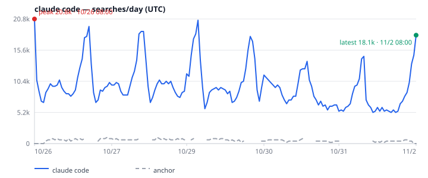
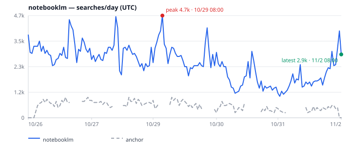
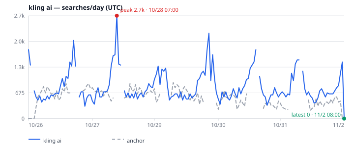

<p align="center">
  <picture>
    <source media="(prefers-color-scheme: dark)" srcset="docs/assets/logo-dark.svg">
    <source media="(prefers-color-scheme: light)" srcset="docs/assets/logo-light.svg">
    
  </picture>
</p>

<p align="center"><b>Search-interest signals for AI agents. One call in, stable JSON out.</b></p>

<p align="center">English | <a href="README.zh-CN.md">简体中文</a></p>

<p align="center"><a href="LICENSE"></a> <a href="https://nodejs.org">= 20"></a>   </p>

> [!WARNING]
> **Unofficial. Not affiliated with or endorsed by Google.** This project calls undocumented public Google Trends web endpoints that can change or fail without notice, and use may conflict with Google's Terms of Service. Use it for light, interactive analysis, not bulk scraping or an SLA.

`google-trends-for-agent` gives agents and humans a predictable way to ask how search interest is changing: a stable JSON envelope, calibrated searches/day estimates, charts, and explicit error codes instead of invented numbers.

<p align="center">
  
</p>
<p align="center"><sub>Real snapshot output, trimmed. The full envelope also includes the series, anchor points, per-query estimates, warnings, and metadata.</sub></p>

## Term gallery

<table>
  <tr><th align="center">Established terms</th><th align="center">New &amp; rising terms</th></tr>
  <tr>
    <td align="center"><br><sub><b>midjourney</b> · peak 4.8k · latest 3.1k searches/day</sub></td>
    <td align="center"><br><sub><b>Sora</b> · peak 8.7k · latest 6.2k searches/day</sub></td>
  </tr>
  <tr>
    <td align="center"><br><sub><b>perplexity</b> · peak 11.4k · latest 6.6k searches/day</sub></td>
    <td align="center"><br><sub><b>claude code</b> · peak 20.8k · latest 18.1k searches/day</sub></td>
  </tr>
  <tr>
    <td align="center"><br><sub><b>notebooklm</b> · peak 4.7k · latest 2.9k searches/day</sub></td>
    <td align="center"><br><sub><b>kling ai</b> · peak 2.7k · latest 0 searches/day</sub></td>
  </tr>
</table>
<p align="center"><sub>Estimates calibrated to the <code>gpts</code> anchor ≈ 550 searches/day; US, last 7 days, labels in UTC, fetched 2026-11-02 UTC.</sub></p>

## Install

Requires Node.js 20+.

```sh
npm install github:meka-im/google-trends-for-agent
npx gtfa --help
# from a checkout: git clone https://github.com/meka-im/google-trends-for-agent.git
# then: cd google-trends-for-agent && npm install && npm run build
```

`gtfa`, `google-trends-for-agent`, and `trends-kit` are aliases for the CLI. The MCP server is installed as `gtfa-mcp` / `google-trends-for-agent-mcp`.

## Quick start

One snapshot, calibrated searches/day:

```sh
npx gtfa snapshot Sora --geo US --json --pretty
```

Start the MCP server over stdio with `npx gtfa-mcp`, or point a client at it:

```json
{
  "mcpServers": {
    "google-trends": { "command": "gtfa-mcp" }
  }
}
```

## MCP tools

| Tool | What it does |
| --- | --- |
| `trends_ask` | Interest, Popular/Rising queries, regions, optional verdict and diff. |
| `trends_snapshot` | Calibrated searches/day, anchor/traffic blocks, verdict, `chart7d` / `traffic7d`. |
| `trends_compare` | Relative 0–100 interest for 2–5 keywords on one shared scale. |
| `trends_now` | Trending Now by country, with rank, growth, categories, and links. |

Inputs, time windows, defaults, and envelope fields are in the [reference](docs/reference.md) and the [MCP field guide](docs/mcp-api.md).

## CLI

| Command | What it does |
| --- | --- |
| `gtfa ask <term>` | One term, with optional `--validate`, `--diff`, `--points`, and batch `--from`. |
| `gtfa snapshot <term>` | Calibrated traffic, related queries, verdict, and SVG charts. |
| `gtfa compare <kw> <kw> [...]` | Relative interest for 1–5 keywords (also `--query` mode). |
| `gtfa now` | Trending Now by country; `--hours` is the Now window. |

Full flags and examples: [reference](docs/reference.md#cli-surface).

## How the numbers work

- `snapshot` puts the term and anchor on one shared 0–100 scale, then calibrates with `traffic = round(score ÷ anchorLevel × dailySearches)`. The built-in US anchor is `gpts` at **550/day** (about 16.5k/month, ±50%).
- Numeric traffic stays `null` unless the anchor has a non-gap point, `anchorLevel ≥ 1`, and at least 25% of non-gap points are nonzero. Sparse 24-hour windows can fail that gate; 7-day windows are denser.
- These are anchor-based **estimates**, not measured Google search volume. When the request is not `now 7-d`, `traffic7d` / `chart7d` come from a separate 7-day fetch; for `now 7-d` they reuse the primary snapshot and chart.
- Failures stay explicit: `ok`, `status`, and `error.code` replace invented numbers, and partial results are reported rather than hidden.

## Docs

- [Reference: CLI, MCP envelopes, exit codes, calibration, limits](docs/reference.md)
- [MCP API field guide (中文)](docs/mcp-api.md)
- [Architecture](docs/assets/architecture.svg)
- [Changelog](CHANGELOG.md)
- [Baselines](examples/baselines.json)

## Development

Tests use local fixtures and mocked transports; they do not call Google.

```sh
npm install
npm test          # 194 tests
npm run typecheck
npm run build
npm run trends -- --help
```

Node.js 20+ is required. `npm run build` writes JavaScript and declarations to `dist/`. The library entrypoint (`src/index.ts`) exports the client, snapshot, calibration, chart, Trending Now, and time-zone APIs.

## License

MIT. See [LICENSE](LICENSE).
