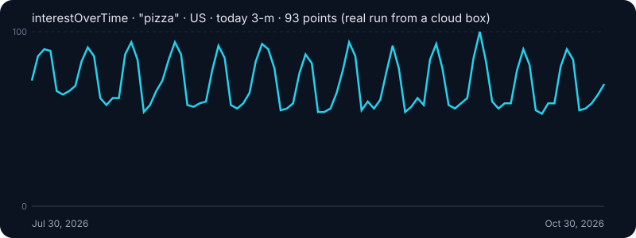
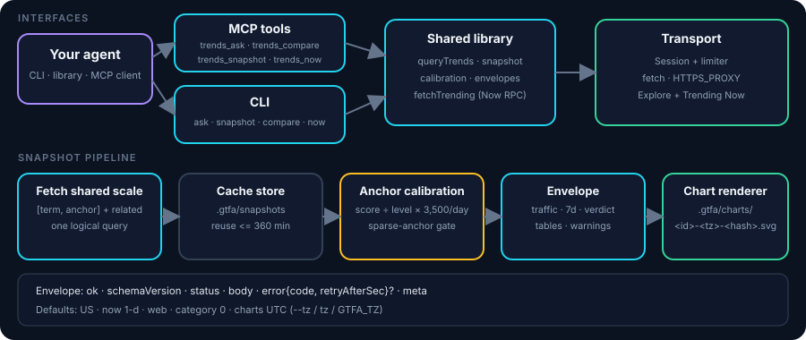

<p align="center">
  <picture>
    <source media="(prefers-color-scheme: dark)" srcset="docs/assets/logo-dark.svg">
    <source media="(prefers-color-scheme: light)" srcset="docs/assets/logo-light.svg">
    
  </picture>
</p>

<p align="center"><b>Search-interest signals for AI agents. One call in, stable JSON out.</b></p>

<p align="center">
  <a href="LICENSE"></a>
  <a href="https://nodejs.org">= 20"></a>
  
  
  
  
</p>

<p align="center">
  <a href="#-quick-start">Quick start</a> ·
  <a href="#-let-your-agent-set-it-up">Agent setup</a> ·
  <a href="#-demo">Demo</a> ·
  <a href="#output-contract">JSON contract</a> ·
  <a href="#error-codes-and-exit-codes">Error codes</a> ·
  <a href="#roadmap">Roadmap</a>
</p>

<p align="center">
  
</p>

> [!WARNING]
> **Unofficial. Not affiliated with or endorsed by Google.** google-trends-for-agent calls undocumented public web endpoints that may change or break without notice, and use may conflict with Google's Terms of Service. Built for **light, interactive use** by agents and humans — not bulk scraping, not an SLA.

google-trends-for-agent gives coding agents (Claude Code, Codex, Cursor, Grok Bot, your own tool-calling loop) a dependable way to ask *"how is interest in X trending?"* — as a shell command or a TypeScript function — and get back a predictable JSON object with explicit failure codes the agent can reason about.

## ⚡ Quick start

```sh
npm install github:meka-im/google-trends-for-agent
npx google-trends-for-agent ask "nano banana" --validate --pretty
npx google-trends-for-agent snapshot Astra --json
google-trends-for-agent snapshot Astra --tz Asia/Shanghai --json
npx google-trends-for-agent compare coffee tea --geo US --time "today 3-m" --pretty
```

`ask` is the quickest验词 path; `snapshot` adds a calibrated searches/day estimate.
`compare` is secondary when you need relative interest for 2–5 known terms.

## 🤖 Let your agent set it up

Paste this into a terminal-capable agent:

```text
Install google-trends-for-agent from github:meka-im/google-trends-for-agent (Node >= 20) and read its README.
Run one query: npx google-trends-for-agent ask "<topic>" --validate --pretty
Treat the JSON on stdout as the result. If status is "error" with code BLOCKED or
RATE_LIMITED, stop and report it instead of retrying in a loop. Summarize the trend
(peak, latest value, direction) in two sentences.
```

## 🎬 Demo

<p align="center">
  
</p>

<p align="center"><sub>Real <code>interestOverTime</code> output (93 daily points) captured from a cloud box and plotted. A short screen recording will replace this — see <a href="#roadmap">Roadmap</a>.</sub></p>

<!-- VIDEO PLACEHOLDER: drag an .mp4 into a GitHub comment/edit box and paste the user-attachments URL on its own line here to embed a player. -->

## 🧭 How it works

<p align="center">
  
</p>

## ✨ What agents get

- One command or one function call to query or compare search interest.
- A stable JSON contract with `ok`, `partial`, and `error` outcomes.
- Explicit `BLOCKED` and `RATE_LIMITED` error codes.
- Sensible exit codes and structured stdout for shell tools; diagnostics on stderr.
- Conservative defaults for light use, including request spacing and stopping batches on blocks.

## Trending Now (what's hot per country)

Explore answers “how is interest in these keywords changing?” Trending Now discovers the searches currently trending in a country, using Google's Trending Now feed. Its volume is a search volume bucket (for example `20K+`), rather than Explore's relative 0–100 index.

```sh
npx google-trends-for-agent now --geo SG --pretty
npx google-trends-for-agent now --geo US,SG,JP --hours 24 --min-volume 5000 --category 18,17 --limit 20
npx google-trends-for-agent now --default-geos --format csv
npx google-trends-for-agent now --list-geos
# Full coverage, sequentially (use sparingly):
npx google-trends-for-agent now --all-geos --hours 4
```

`--hours` accepts 4, 24 (default), 48, or 168; `--lang` defaults to `en`. Category filters match any supplied id; `--limit` applies after filtering. Ranks retain Google's original order and can have gaps after filtering. Use `--list-geos` or the exported `TRENDING_GEOS` for the full 120-country/region coverage list (verified live 2026-10-30; 12 small markets such as IS, LU, MT returned no Trending Now data and are excluded). `DEFAULT_TRENDING_GEOS` selects 30 countries across the Americas, Europe, Africa, Asia, and Oceania. Both exports contain `{ code, name }` entries. Geo codes are case-insensitive; Explore subdivisions are not accepted here.

```ts
import { fetchTrending, listTrending, diffTrending, trendsNowToTrendingResponses, diffTrendsNow, DEFAULT_TRENDING_GEOS } from 'google-trends-for-agent';

const snapshot = await fetchTrending({ geo: 'SG', hours: 24, limit: 20 });
const batch = await listTrending({ geos: ['US', 'SG', 'JP'], minVolume: 5000 });
// Full selector: listTrending({ geos: 'all' });
const next = await fetchTrending({ geo: 'SG' }); // take later, not in a polling loop
const changes = diffTrending(snapshot, next);
```

Illustrative output (one item):

```json
{
  "status": "ok",
  "geo": "SG",
  "hours": 24,
  "fetchedAt": "2026-10-30T00:00:00.000Z",
  "items": [{
    "rank": 1, "title": "Example topic", "query": "example topic", "geo": "SG",
    "volume": 20000, "volumeLabel": "20K+", "growthPct": 1000,
    "categoryIds": [18], "categories": ["Technology"],
    "startedAt": "2026-10-29T12:00:00.000Z", "endedAt": null, "active": true,
    "relatedQueries": ["example topic"], "newsCount": 2
  }],
  "meta": { "upstreamRequests": 1, "durationMs": 180 }
}
```

`fetchTrending` returns input and upstream failures as structured errors. `listTrending` returns `{ status, results, summary: { geos, ok, failed } }` and shares a limiter across sequential requests (1500 ms default). On `BLOCKED`, remaining geos receive `BLOCKED` / `skipped after upstream block`; set `stopOnBlocked: false` only when appropriate. Options accept the existing custom `transport`, `now`, and `sleep`, plus `limiter`, `minIntervalMs`, and `timeoutMs`. The default transport supports `HTTPS_PROXY`. Each geo uses one POST request with no automatic retries. CLI exit codes follow the table below, including block/rate-limit precedence in batches.

`diffTrending` compares normalized queries and returns latest items in `added` and `rising` (volume increased), previous items in `removed`, and an `unchanged` count for remaining matched queries. For MCP/`trends_now` JSON that uses `traffic`/`trafficLabel`, call `trendsNowToTrendingResponses` first (or `diffTrendsNow` for a multi-geo envelope). Compare successful snapshots with the same geo, hours, and filters; volume buckets can remain unchanged while real traffic changes. Category ids are preserved; unknown ids use `Category <id>` names. News references are counted without fetching articles.

For agents: choose a few relevant countries, make one call per geo, and don't poll faster than every 15 minutes. Keep this to light, interactive use. Stop on a block; respect rate limits. The full-country selectors are coverage tools, not invitations to continuous scraping.

## Run locally

Requires Node.js 20+. Install globally from git (the `prepare` script builds the executable files):

```sh
npm install -g github:meka-im/google-trends-for-agent
```

Or clone and link the local checkout:

```sh
git clone https://github.com/meka-im/google-trends-for-agent.git
cd google-trends-for-agent
npm install
npm link
```

```sh
google-trends-for-agent ask "nano banana" --validate --diff
google-trends-for-agent snapshot Astra --json
google-trends-for-agent compare coffee tea --geo US --time "today 3-m"
google-trends-for-agent --query coffee --query tea --geo US --time "today 3-m"
google-trends-for-agent now --geo SG --hours 24 --limit 20
google-trends-for-agent --help
google-trends-for-agent help now
google-trends-for-agent help ask
google-trends-for-agent help snapshot
google-trends-for-agent --version
```

The CLI has four commands: `ask`, `snapshot`, `compare` (the default `--query` mode is the same; both default to `--geo US --time "now 1-d"` like MCP, honoring `gtfa.config.json` / `GTFA_GEO` / `GTFA_TIME`; `--url` and `--start/--end` keep their own range) and `now` (Trending Now; `--hours` is the trending window 4/24/48/168, separate from the Explore `--time` range). `snapshot` adds a shared-scale `gpts` anchor and returns a calibrated searches/day estimate, related-query estimates, and a chart file path (inline SVG text only with `--svg`). Chart labels use UTC by default; pass `--tz <IANA>` (for example `--tz Asia/Shanghai`) or set `GTFA_TZ` to choose another time zone. Names are validated and canonicalized with `Intl.DateTimeFormat`, so case variants share one label and chart file. `gtfa` and `trends-kit` remain CLI aliases. JSON is the default stdout format, including version and unknown-flag errors (exit 4); help prints plain text on an interactive TTY and JSON when piped or with `--json`. Explicitly request CSV with `--format csv`. Diagnostics go to stderr. By default `ask` omits the full `interest.points` series (use `--points`), and `snapshot` omits inline SVG text (use `--svg`) to keep agent context small.

## MCP server (local, stdio)

After the global install above, start `google-trends-for-agent-mcp` (alias `gtfa-mcp`). The server uses stdin/stdout only for MCP protocol messages; diagnostics go to stderr. It shares one client and rate limiter across tools, with 1500 ms default request spacing and the existing `HTTPS_PROXY` transport support. There is no hosted service to configure.

Claude Code:

```sh
claude mcp add google-trends -- google-trends-for-agent-mcp
# Or use a built checkout:
claude mcp add google-trends -- node /abs/path/google-trends-for-agent/dist/mcp-bin.js
```

Prefer these installed commands over `npx -y github:meka-im/google-trends-for-agent google-trends-for-agent-mcp`: that form can select the CLI executable instead of the MCP server.

Cursor (`.cursor/mcp.json`):

```json
{
  "mcpServers": {
    "google-trends": {
      "command": "google-trends-for-agent-mcp",
      "env": { "HTTPS_PROXY": "" }
    }
  }
}
```

Generic JSON config for clients using `mcpServers` (adjust the absolute path):

```json
{
  "mcpServers": {
    "google-trends": {
      "command": "node",
      "args": ["/abs/path/google-trends-for-agent/dist/mcp-bin.js"],
      "env": { "HTTPS_PROXY": "" }
    }
  }
}
```

Use an absolute executable path if the client does not inherit your shell's PATH. To use a proxy, set `HTTPS_PROXY` to its URL. Empty proxy variables select direct access unless lowercase `https_proxy` is also set. Set `GTFA_SNAPSHOT_DIR` / `GTFA_CHART_DIR` when the MCP process runs in a read-only working directory (otherwise snapshots go to `.gtfa/snapshots` and charts to `.gtfa/charts`). Set `GTFA_TZ` to an IANA time zone to change chart labels for the whole process (default `UTC`).

The MCP server exposes exactly **four** agent-facing tools. For a readable Chinese field guide (inputs, example JSON envelopes, glossary), see [docs/mcp-api.md](docs/mcp-api.md) (*Chinese field guide*). `trends_ask`, `trends_compare`, and `trends_snapshot` share the same defaults: `geo` = `US`, `time` = `now 1-d`, web search, all categories (0). `trends_now` defaults to the 30-country set and `hours` = 24. `time` is one of `now 1-H`, `now 4-H`, `now 1-d`, `now 7-d`, `today 1-m`, `today 3-m`, `today 12-m`, `today 5-y`, `all`. `trends_snapshot` uses the shared-scale anchor `gpts` by default and estimates daily searches; without a matching geo/anchor calibration (or when the anchor is too sparse/weak) its numeric `traffic` fields are `null`. `trends_ask` omits full `interest.points` by default (`points: true` includes it); `trends_snapshot` omits inline SVG text by default (`svg: true` embeds it, while `chart.path` is still written).

### Inputs

| Tool | Param | Type | Default | Meaning |
| --- | --- | --- | --- | --- |
| `trends_ask` | `term` | string (required) | — | The one term to look up |
| | `geo` | string | `US` | Country or region code (`US`, `US-CA`) |
| | `time` | enum above | `now 1-d` | Time range |
| | `fresh` | boolean | `false` | `false` reuses a saved snapshot under 360 min; `true` fetches live |
| | `validate` | boolean | `false` | Add a verdict (anchor `gpts`, US calibration) |
| | `points` | boolean | `false` | Include the full `interest.points` series (omitted by default) |
| `trends_snapshot` | `term` | string (required) | — | Term to estimate in searches/day |
| | `geo` | string | `US` | Country or region code |
| | `time` | enum above | `now 1-d` | Time range |
| | `anchor` | string | `gpts` | Shared-scale anchor term |
| | `fresh` | boolean | `false` | `false` reuses a saved term+filter+anchor snapshot under 360 min; `true` fetches live |
| | `svg` | boolean | `false` | Embed inline `chart.svg` / `chart7d.svg` text; paths are still written by default |
| | `tz` | string | `GTFA_TZ`, then `UTC` | IANA time zone for chart labels, canonicalized via `Intl.DateTimeFormat`, e.g. `Asia/Shanghai`; invalid names return `INVALID_INPUT` |
| `trends_compare` | `keywords` | string[2–5] (required) | — | Terms to compare, e.g. a candidate plus an anchor |
| | `geo` | string | `US` | Country or region |
| | `time` | enum above | `now 1-d` | Time range |
| `trends_now` | `geos` | string[] \| `"default"` \| `"all"` | `"default"` (30 countries) | Countries; the supported list is in the tool description |
| | `hours` | 4 \| 24 \| 48 \| 168 | `24` | Trending Now window in hours (not the Explore `time` enum) |
| | `limit` | integer ≥ 0 | `10` | Items per country |

### Outputs

Every tool result is JSON text plus identical `structuredContent`. Arguments rejected by the MCP schema validator (e.g. one keyword for `trends_compare`) are normalized into the same envelope: `ok: false`, `status: "error"`, `error: { code: "INVALID_INPUT", message }`, `meta`. Keys come in the same order for all four tools: `ok`, `schemaVersion`, `status`, the tool-specific body, `error` (only on failure), then `meta`. `ok: false` also sets MCP `isError: true` and carries `error: { code, message, retryAfterSec? }` (codes: `INVALID_INPUT`, `BLOCKED`, `RATE_LIMITED`, `TRENDS_TIMEOUT`, `TRENDS_PROTOCOL_CHANGED`, `TRENDS_TEMPORARILY_UNAVAILABLE`, `NETWORK_ERROR`, …).

**`trends_ask`**

| Field | Type | Meaning |
| --- | --- | --- |
| `ok`, `schemaVersion` | boolean, number | Envelope |
| `status` | `ok` \| `no_data` \| `partial` \| `blocked` \| `error` | Snapshot status (`no_data` and `partial` are still `ok: true`; `partial` keeps upstream warnings) |
| `term` | string | The term asked |
| `summary` | string | One-line human summary |
| `filter` | `{ geo, time, category, property }` | Filter used (`property: "web"`) |
| `interest` | `{ average, latest, settledLatest, peak, gapCount, points?: [{ t, value, gap? }] }` | Interest over time, 0–100; `settledLatest` ignores unsettled tail points. Full `points` is omitted by default and included with `points: true` / `--points` |
| `tables.popular` | `[{ rank, query, value, formattedValue }]` | Top related queries (relative 0–100; about 25 rows from Google) |
| `tables.rising` | `[{ rank, query, value, formattedValue, breakout }]` | Rising related queries; `value` is % growth, `formattedValue` is `+250%` or `Breakout` |
| `regions` | `[{ geo, name, value }]` | Interest by subregion, highest first |
| `verdict` | only with `validate: true`: `{ label, confidence, reasons[], traffic: { unit, average, latest, settledLatest, peak, low, high, gapCount } \| null, estimate: { low, mid, high } \| null, anchor: { term, ratio, band, note }, warnings?, freshSpike?, trendingNow?, retryAfterSec? }` | `label`: `spiking`, `rising`, `steady`, `flat`, `no_data`, `blocked`. `traffic` is searches/day using the same helper/formula as `trends_snapshot`; `estimate` is a legacy monthly compat field (`traffic.average × 30`). Both are null (无法估) without calibration or when the anchor gate fails |
| `diff` | `{ term, filter, from, to, newPopular[], droppedPopular[], newRising[], risingUp[], regionMoves[], interestDelta }` \| `null` | Changes since the previous saved snapshot for the same term and filter (the raw `diffSnapshots` result; `from`/`to` are snapshot ids, `filter.property` is `""` for web) |
| `diffReason` | string | Why `diff` is null (`Need two snapshots`) |
| `meta` | `{ cached, ageMin, fetchedAt, snapshotId, exploreUrl, warnings? }` | `cached: true` means a saved snapshot was reused; warnings include upstream partial-response warnings and excluded gap points |
| `error` | `{ code, message, retryAfterSec? }` | Only on failure |

**`trends_snapshot`**

| Field | Type | Meaning |
| --- | --- | --- |
| `ok`, `schemaVersion`, `status` | boolean, number, `ok` \| `no_data` \| `partial` \| `blocked` \| `error` | Envelope (`no_data` and `partial` are still `ok: true`) |
| `term`, `summary` | string, string | Term and one-line estimate summary |
| `filter` | `{ geo, time, category, property }` | Filter used (`property: "web"`) |
| `anchor` | `{ term, dailySearches, tolerance, level, ratio, source, note }` | Shared-scale anchor; `level` is the gap-aware anchor mean with 2 decimals (e.g. `0.18`, never a lying `0`), `ratio` = term mean ÷ anchor mean (2 decimals) or `null` when the anchor fails the reliability gate; `dailySearches`/`tolerance` are `null` without calibration |
| `traffic` | `{ unit, average, latest, settledLatest, peak, low, high, gapCount }` | `unit: "searches/day"`; aggregates exclude gaps; `low`/`high` apply the anchor tolerance to `average`; numeric fields are `null` without calibration or when the anchor is too sparse/weak |
| `series` | `{ points: [{ t, score, traffic, gap? }], anchorPoints: [{ t, score }] }` | Raw 0–100 scores and per-point daily traffic on the shared scale |
| `chart` | `{ svg, path }` | Default `svg: ""` to keep payloads small; `path` points at the written `.gtfa/charts/<snapshotId>-<tz-slug>-<sha1-8>.svg` (for example `-utc-bdfd4d8d.svg` or `-asia-shanghai-b485a3cf.svg`; the short SHA-1 of the canonicalized IANA zone name keeps names collision-free) (`null` if writing is disabled/failed). Set `svg: true` / `--svg` to embed the ~720×280 SVG text (gap points omitted, peak/latest marked, anchor dashed; labels use the selected time zone, default `UTC`) |
| `chart7d` | `{ svg, path }` | Always present; the `now 7-d` curve. `svg` is `""` unless `svg: true` / `--svg`; `path` is still written. If the extra week fetch is unavailable, `{ svg: "", path: null }` plus a warning |
| `traffic7d` | same shape as `traffic` | Always present; numeric fields are `null` (and `gapCount` is `0`) when the week fetch is unavailable |
| `tables.popular` | `[{ rank, query, value, formattedValue, estDaily }]` | `estDaily = round(value / 100 × traffic.average)` |
| `tables.rising` | `[{ rank, query, value, formattedValue, breakout, estDaily }]` | `estDaily` is available only when the same query also appears in Popular; otherwise `null` |
| `verdict` | `{ label, confidence, reasons[], prioritize }` | `label`: `rising`, `spiking`, `steady`, `fading`, `no_data`; `prioritize = traffic.settledLatest >= 300` |
| `meta` | `{ cached, ageMin, fetchedAt, snapshotId, exploreUrl, warnings? }` | `cached: true` means a saved term+filter+anchor snapshot was reused; warnings include partial upstream responses, unavailable 7-day data, and excluded gaps |
| `error` | `{ code, message, retryAfterSec? }` | Only on failure |

Both `trends_snapshot` and `trends_ask` (`validate: true`) use the **same calibration helper**: `traffic = round(score ÷ anchorLevel × anchorDailySearches)`, where `anchorLevel` is the gap-aware mean of the anchor's points over the same shared-scale comparison. Daily traffic is the source of truth; the legacy monthly `verdict.estimate` is derived as `daily × 30`. The built-in default is `gpts` = **550 US searches/day, ±50%** (≈16.5k/month); `examples/baselines.json` can override it and library callers may pass `baselines`. **Anchor reliability gate:** calibration requires at least one non-gap anchor point, `anchorLevel ≥ 1` (Trends' integer scale), and at least 25% of non-gap anchor points nonzero. If it fails, `ratio` and numeric `traffic` fields are `null`, `anchor.level` stays precise (e.g. `0.18`), and `anchor.note` / `meta.warnings` say `anchor too sparse/weak for calibration; traffic omitted`; the verdict still uses related-query and shape signals. Without a matching `geo + anchor` calibration, numeric `traffic` fields and `estDaily` are `null` with a note/warning. These are anchor estimates, not measured search volume.

**`trends_compare`**

| Field | Type | Meaning |
| --- | --- | --- |
| `ok`, `schemaVersion` | boolean, number | Envelope |
| `status` | `ok` \| `partial` \| `error` | Upstream result |
| `filter` | `{ geo, time }` | Filter used |
| `summary` | string | One-line latest/peak summary for every keyword |
| `series` | `[{ keyword, points: [{ t, value }], average, latest, peak }]` | One series per keyword, in input order; values are relative 0–100 across all keywords in the call. `latest` / `peak` are gap-aware |
| `meta` | `{ fetchedAt, upstreamRequests, durationMs, warnings[] }` | Request info |
| `error` | `{ code, message, retryAfterSec? }` | Only on failure |

**`trends_now`**

| Field | Type | Meaning |
| --- | --- | --- |
| `ok`, `schemaVersion` | boolean, number | Envelope (`ok` is true when at least one country succeeded) |
| `status` | `ok` \| `partial` \| `error` | Overall result |
| `hours` | number | Window used |
| `geos` | string[] | Countries in the response, in order |
| `summary` | `{ geos, ok, failed }` | Counts |
| `byGeo` | `[{ geo, ok, fetchedAt, items, error? }]` | One entry per country; countries after a block are skipped with an error |
| `byGeo[].items` | `[{ rank, title, query, traffic, trafficLabel, growthPct, startedAt, endedAt, active, categories[], relatedQueries[], newsCount, link }]` | `traffic` is Google's approximate search count, `trafficLabel` like `2K+`, `link` is an Explore URL |
| `error` | `{ code, message, retryAfterSec? }` | First failure, when any country failed |
| `meta` | `{ fetchedAt }` | Response time |

`trends_compare` rejects duplicate keywords (case- and whitespace-insensitive) with `INVALID_INPUT`. With `validate: true`, a blocked verdict (for example the anchor comparison was blocked or rate-limited) returns `ok: false`, `status: "blocked"` and `error`, even if the term itself was fetched.

There are no other MCP tools and no legacy aliases.

**Migration (breaking):** `trending_list` → `trends_now`; CLI `trending` → `now`; `trends_query` → `trends_compare`; `trends_validate`/`trends_diff` → `trends_ask` (`validate`; diff is always returned); `trending_now`/`trending_geos`/`trending_diff` → `trends_now` or the library. The `GTFA_MCP_LEGACY_ALIASES` switch is gone. CLI `validate`/`diff` → `ask --validate` / `ask --diff`. The old `trends_snapshot` / CLI `snapshot` alias (which only saved an `ask` snapshot) is replaced by the new calibrated `trends_snapshot` / `snapshot` tool; its `traffic` and `chart` fields are new and incompatible with the old alias. Lower-level options (category, property, custom dates, data types, anchors, language, volume filters) stay in the library (`queryTrends`, `snapshotTerm`, `snapshotTrafficTerm`, `trafficSnapshotEnvelope`, `diffSnapshots`, `trendsNowToTrendingResponses`, `diffTrendsNow`, `validateTerms`, `fetchTrending`, `listTrending`, `diffTrending`, `TRENDING_GEOS`), `gtfa.config.json`, and the CLI.

Agent tips: pick a few relevant countries from the `trends_now` description, and keep use light. On `BLOCKED`, stop and report. On `RATE_LIMITED`, wait at least `retryAfterSec` before a bounded retry; if absent, back off conservatively. Inspect `status`, errors, and warnings before summarizing. To diff two saved `trends_now` envelopes, convert with `trendsNowToTrendingResponses` (maps `traffic`/`trafficLabel` → `volume`/`volumeLabel`) then call `diffTrending` per geo, or use `diffTrendsNow(prev, next)` which does both:

```js
import { trendsNowToTrendingResponses, diffTrendsNow, diffTrending } from 'google-trends-for-agent';
const [sg] = trendsNowToTrendingResponses(savedNowEnvelope); // traffic → volume
diffTrending(sgPrev, sgNext);
diffTrendsNow(prevEnvelope, nextEnvelope); // all geos
```

Avoid polling more often than once per geo every 15 minutes; use `"all"` sparingly.

For embedding/tests, import `createServer` from `src/mcp.ts` (or built `dist/mcp.js`). It returns an unconnected `McpServer`; connect your MCP transport with `server.connect(...)`. Its optional `transport` option injects the HTTP transport, allowing fully offline tests.

## Install

Requires Node.js 20+ and access to the repository.

```sh
npm install github:meka-im/google-trends-for-agent
npx google-trends-for-agent --help
```

Or clone and build:

```sh
git clone https://github.com/meka-im/google-trends-for-agent.git
cd google-trends-for-agent
npm install
npm run build
node dist/cli.js --help
```

The `prepare` script builds JavaScript and TypeScript declarations when installing from git. The `trends-kit` command remains an alias for compatibility; use `google-trends-for-agent` for new integrations.

## Quick start for shell agents

```sh
npx google-trends-for-agent --query coffee --geo US --time 'today 1-m' --pretty
npx google-trends-for-agent --query coffee --query tea --types interestOverTime --pretty
npx google-trends-for-agent --query coffee --start 2025-01-01 --end 2025-02-01 --format csv
npx google-trends-for-agent --url 'https://trends.google.com/trends/explore?q=coffee&date=today%201-m' --pretty
npx google-trends-for-agent --version
```

Repeat `--query` to compare 1–5 keywords. Repeat `--url` for sequential independent queries; do not combine URLs with keywords. Choose `--time` or `--start` with `--end`. `--types` accepts a comma-separated list of `interestOverTime` (default), `interestByCity`, `interestByMetro`, `interestBySubregion`, `relatedQueries`, or `relatedTopics`.

JSON is the default; `--pretty` indents it. CSV includes tables, metadata, and errors. Query and usage failures also return structured stdout. Help and version return JSON objects (`{ "help": "..." }` and `{ "name": "...", "version": "..." }`). Tune requests with `--timeout 8000`, `--retries 1`, and `--min-interval 1000`.

## Library

```ts
import { queryTrends, compareTrends, batchTrends } from 'google-trends-for-agent';

const result = await queryTrends({
  queries: ['coffee'], geo: 'US', timeRange: 'today 1-m',
  dataTypes: ['interestOverTime'],
});

const comparison = await compareTrends(['coffee', 'tea'], {
  geo: 'US', dataTypes: ['interestOverTime'],
});

// Small, sequential workloads sharing one client and rate limiter.
const batch = await batchTrends([
  { queries: ['coffee'] },
  { queries: ['tea'] },
], { stopOnBlocked: true });
```

`queryTrends` returns input and upstream failures as responses. `compareTrends` accepts input fields and client options. `batchTrends` returns `{ status, results }` with zero-based `index` fields. With `stopOnBlocked: true` (the default), remaining items get `BLOCKED` with message `skipped after upstream block`. Mixed or incomplete success is `partial`; all failed items produce `error`.

Inputs also support `category`, `searchType`, `locale`, `timezoneOffsetMinutes`, `timeoutMs` (1000–60000), and `maxRetries` (0–2, default 1). Use `startDate`/`endDate` instead of `timeRange` for absolute dates. Reuse `new TrendsClient({ minIntervalMs: 1000 })` through `{ client }` options to share request spacing across calls.

Chart APIs accept a `timeZone` option (`renderTrafficChart`, `fetchTrafficSnapshot`, and `trafficSnapshotEnvelope`). Resolution order is explicit `timeZone` > `GTFA_TZ` > `UTC`; values are validated and canonicalized with `Intl.DateTimeFormat` (for example, case variants of `America/Argentina/ComodRivadavia` resolve to `America/Catamarca` and share labels and chart files), and invalid IANA names throw an `INVALID_INPUT` error. `resolveTimeZone` and `validateTimeZone` are exported for wrappers.

## Output contract

Illustrative successful response (timeline rows omitted):

```json
{
  "status": "ok",
  "input": { "queries": ["coffee"], "geo": "US", "timeRange": "today 1-m", "dataTypes": ["interestOverTime"] },
  "data": { "interestOverTime": { "timeline": [], "averages": null } },
  "meta": { "upstreamRequests": 3, "durationMs": 2200, "warnings": [], "fetchedAt": "2026-10-30T00:00:00.000Z" }
}
```

Error response:

```json
{
  "status": "error",
  "input": { "queries": ["coffee"] },
  "data": {},
  "error": { "code": "RATE_LIMITED", "message": "upstream rate limit reached", "retryAfterSec": 30 },
  "meta": { "upstreamRequests": 1, "durationMs": 200, "warnings": [], "fetchedAt": "2026-10-30T00:00:00.000Z" }
}
```

Responses always contain `status`, `input`, and `meta`. Valid inputs are normalized; validation failures retain the original input. `data` and `error` are optional; `retryAfterSec` appears when supplied by upstream. Partial responses retain successful sections and describe missing data in `meta.warnings`. Errors can also retain data fetched before failure. Multiple-keyword related data uses `relatedQueriesByQuery` / `relatedTopicsByQuery` arrays.

A logical query can make several upstream requests. Values are relative Google Trends indices, not absolute search volumes.

## Error codes and exit codes

| Code / outcome | CLI exit | Meaning |
| --- | --- | --- |
| `ok` | 0 | Complete success |
| `partial` | 2 | Incomplete or mixed success |
| `BLOCKED` | 3 | Challenge or unusual traffic detected |
| `RATE_LIMITED` | 3 | Upstream rate limit |
| `INVALID_INPUT` | 4 | Invalid input or CLI usage |
| `INVALID_COMBINATION` | 4 | Incompatible options |
| `REQUEST_TOO_LARGE` | 1 | Request exceeds supported size |
| `TRENDS_TIMEOUT` | 1 | Request timed out |
| `TRENDS_PROTOCOL_CHANGED` | 1 | Unexpected upstream response |
| `TRENDS_TEMPORARILY_UNAVAILABLE` | 1 | Upstream server failure |
| `NETWORK_ERROR` | 1 | Transport connection failure |

For batches, exit precedence is blocked/rate-limited, invalid input, partial success, then other errors.

## Copy-paste for agents

Tool description / prompt snippet:

> Use google-trends-for-agent to retrieve relative Google Trends search interest for 1–5 keywords in one command or function call. Inspect status, error.code, and meta.warnings before using results. On BLOCKED, stop and report the block. On RATE_LIMITED, wait retryAfterSec before a limited retry. Use available sections from partial results and disclose gaps. Keep workloads small; never hammer blocked endpoints.

Example function-calling definition for a wrapper that calls `queryTrends(arguments)`:

```json
{
  "type": "function",
  "function": {
    "name": "queryTrends",
    "description": "Get relative Google Trends search interest. Light use only; returns status, data, error, and meta.",
    "parameters": {
      "type": "object",
      "properties": {
        "queries": { "type": "array", "items": { "type": "string" }, "minItems": 1, "maxItems": 5 },
        "geo": { "type": "string", "description": "Country or region, for example US" },
        "timeRange": { "type": "string", "description": "For example today 1-m" },
        "dataTypes": {
          "type": "array",
          "items": { "type": "string", "enum": ["interestOverTime", "interestByCity", "interestByMetro", "interestBySubregion", "relatedQueries", "relatedTopics"] }
        }
      },
      "required": ["queries"],
      "additionalProperties": false
    }
  }
}
```

A Trending Now wrapper can call `fetchTrending(arguments)` with this tool definition:

```json
{
  "type": "function",
  "function": {
    "name": "fetchTrending",
    "description": "Discover trending searches in one country. Inspect status and error; stop on BLOCKED. Light use, at most once per geo every 15 minutes.",
    "parameters": {
      "type": "object",
      "properties": {
        "geo": { "type": "string", "description": "Supported country code, e.g. SG, US, JP" },
        "hours": { "type": "integer", "enum": [4, 24, 48, 168], "default": 24 },
        "lang": { "type": "string", "default": "en" },
        "minVolume": { "type": "integer", "minimum": 0 },
        "categories": { "type": "array", "items": { "type": "integer" } },
        "limit": { "type": "integer", "minimum": 0 }
      },
      "required": ["geo"],
      "additionalProperties": false
    }
  }
}
```

These function definitions describe library wrappers. The local MCP server below exposes the same APIs through four tools.

## How agents should handle failures

- `BLOCKED`: stop and report. Do not hammer the endpoint or continue the batch.
- `RATE_LIMITED`: wait at least `retryAfterSec` when present before retrying. If absent, back off conservatively. Keep retries bounded.
- `partial`: use what is available, inspect `meta.warnings`, and report gaps.
- Invalid input: correct the request before retrying. Other failures: report them or use a bounded retry appropriate to the task.

## Transport and HTTPS_PROXY

The default transport uses fetch, cookies scoped to each logical query, timeouts, and no automatic redirects. Set `HTTPS_PROXY` (or `https_proxy`) to use an HTTP CONNECT proxy through Undici:

```sh
HTTPS_PROXY=http://localhost:8080 npx google-trends-for-agent --query coffee --pretty
```

A custom `Transport` passed as `{ transport }` replaces the default transport, including proxy handling. It receives `{ url, method, headers, timeoutMs, body? }`, returns `{ status, headers, body }`, and must enforce its own timeout. Client options include `minIntervalMs` and injectable `now`/`sleep` for tests.

## Rate limits and light use

Measured success was high at low volume (about 77%) and fell sharply (about 5%) after hundreds of sequential queries from one shared cloud IP. These observations are environment-specific, not a reliability guarantee. Use small workloads; this is unsuitable for bulk scraping or an SLA.

The default minimum interval is one second between upstream requests. Reuse a client or use `batchTrends` to share the limiter. Block/rate-limit signals apply adaptive backoff up to 60 seconds; successes reduce the penalty. `BLOCKED` and `RATE_LIMITED` return immediately without automatic retry. Transient server, timeout, and network failures may retry up to `maxRetries`. More retries or different proxies do not guarantee access.

## Roadmap

- Record a 20–30s demo video / GIF (agent asks → google-trends-for-agent JSON → summary) to replace the static demo.

- [x] Local stdio MCP server with four tools.
- More egress adapters.

## Development

Tests use local fixtures and mocked transports; they do not call Google.

```sh
npm install
npm test
npm run typecheck
npm run build
```

`npm run trends -- --help` runs the CLI from source.

## License

MIT. See [LICENSE](LICENSE).

## Validate new terms (pairs with new-term-radar)

Verdicts: `spiking` (past-24h / short windows only: the last 1-2 settled points are at least 3× the rest of the window, at least 20 absolute and 15 over the mean; medium confidence, `freshSpike.recheckAfterMin` = 60), `rising`, `steady`, `flat`, `no_data`, `blocked`. All terms in one run share a single anchor comparison (up to 4 terms + `gpts` per request), so estimates are on the same scale. `--fresh` (MCP `fresh: true`) skips the snapshot cache.

Validate names from discovery reports with Google Trends interest, related queries,
and regions. Defaults are US, past 24 hours, all categories, and web.

```sh
gtfa ask "new product"                       # interest + Popular + Rising + regions (reuses a snapshot ≤360 min)
gtfa ask "new product" --validate --json      # add a verdict
new-term-radar leads --json | gtfa ask --validate --from - --json
gtfa ask --validate --from report.json --geo US --time "today 1-m" --trending
gtfa ask "new product" --fresh --diff         # live fetch, then diff vs the previous snapshot
gtfa compare "new product" gpts               # relative interest vs an anchor
```

`ask --validate` prints a compact table; `--json` returns the verdict array. Use
`--no-anchor` to skip comparison, `--anchor gpts` to select the anchor, and
`--store DIR` to change snapshot storage (default `.gtfa/snapshots`).
Fresh snapshots are reused for 360 minutes. `ask --refresh never` uses only
saved data; `ask --refresh always` (or `--fresh`) fetches again. `--diff` (output is always JSON) compares the two latest
saved snapshots for the same term and filter.

MCP workflow: take names from new-term-radar's `recent_leads`, then call:

```json
{"name":"trends_ask","arguments":{"term":"new product","validate":true}}
```

Call `trends_ask` once per lead (or use CLI `gtfa ask --validate --from -` for batches). Every answer includes `diff` against the previous snapshot (or `null`).

Filters resolve in this order: call arguments, optional `gtfa.config.json` in
the working directory, `GTFA_GEO` / `GTFA_TIME`, defaults. Chart time zones
resolve as explicit `timeZone` / `--tz` / MCP `tz`, then `GTFA_TZ`, then `UTC`. For example:

```json
{"geo":"US","time":"now 1-d","category":0,"property":""}
```

An empty property means web. Library exports include `resolveFilter`,
`snapshotTerm`, `SnapshotStore`, `askTerm`, `diffSnapshots`, `trendsNowToTrendingResponses`, `diffTrendsNow`,
`parseNtrInput`, and `validateTerms`.

Verdicts use settled interest: daily series drop their last two unsettled
points, so a rise must hold through the third-from-last point. Hourly
`now 1-d` and `now 7-d` series drop only the final partial point. Coarser
series also drop their final point. The final half's mean must be at least
1.5 times the earlier half's mean for “rising”; breakout related queries
also qualify. A settled peak of at least 10 with no decline is “steady”;
otherwise the verdict is “flat”. Missing or all-zero settled data yields
`no_data`; blocks and rate limits yield `blocked`. The `ask` CLI returns
exit 3 for blocked/rate-limited envelopes, 2 for partial results, 1 for other
upstream errors, and 0 for ok/no_data (validation uses the same mapping).

Calibration uses a same-filter shared-scale comparison against `gpts`, taking
the gap-aware mean ratio over the full comparison window. `trends_ask
--validate` and `trends_snapshot` call the same helper:
`traffic = score ÷ anchorLevel × dailySearches`. Daily traffic is the source
of truth; `verdict.estimate` is a legacy monthly compat field derived as
`daily × 30`. The recipe baseline is approximately **550 US searches/day, ±50%**
(≈16,500/month); this is an anchor estimate, not measured volume. Bands are high
at ratio ≥1, mid at ≥0.1, and low below 0.1.

The anchor reliability gate requires at least one non-gap anchor point,
`anchorLevel ≥ 1` (Trends' integer scale), and at least 25% of non-gap anchor
points nonzero. Sparse/near-zero anchors (for example `gpts` on a quiet
`now 1-d` with only a few nonzero points) produce `ratio: null` and numeric
`traffic: null` with `anchor too sparse/weak for calibration; traffic omitted`;
`anchor.level` keeps 2 decimals instead of rounding to a misleading `0`. The
verdict still uses related-query and shape signals. Without a matching geo/anchor
calibration, numeric traffic and `estMonthly` are null (无法估).
Library callers can supply `baselines`; baseline files support `dailySearches`
and legacy `monthlySearches` (monthly = daily × 30). `trends_snapshot` /
`gtfa snapshot` uses the same default (with a matching `baselines` entry when
provided) to estimate searches/day and writes a chart file.
