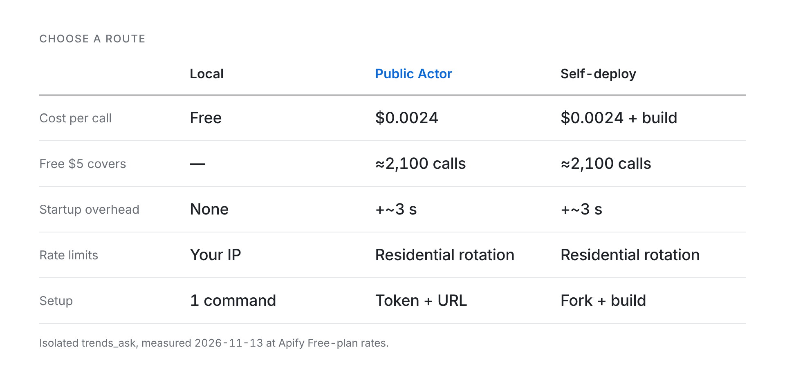
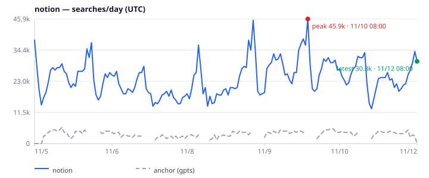
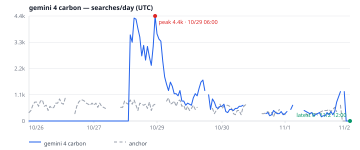

<p align="center">
  <picture>
    <source media="(prefers-color-scheme: dark)" srcset="docs/assets/logo-dark.svg">
    <source media="(prefers-color-scheme: light)" srcset="docs/assets/logo-light.svg">
    
  </picture>
</p>

<p align="center"><b>Search-interest signals for AI agents. One call in, stable JSON out.</b></p>

<p align="center">English | <a href="README.zh-CN.md">简体中文</a></p>

<p align="center"><a href="https://apify.com/meka.im/google-trends-for-agent"></a> <a href="LICENSE"></a> <a href="https://nodejs.org">= 20"></a>   </p>

<p align="center"><a href="https://apify.com/meka.im/google-trends-for-agent"> <strong>Open in Apify Store →</strong></a></p>

> [!WARNING]
> **Unofficial. Not affiliated with or endorsed by Google.** This project calls undocumented public Google Trends web endpoints that can change or fail without notice, and use may conflict with Google's Terms of Service. Use it for light, interactive analysis, not bulk scraping or an SLA.

`google-trends-for-agent` gives agents and humans a predictable way to ask how search interest is changing: a stable JSON envelope, calibrated searches/day estimates, charts, and explicit error codes instead of invented numbers.

<p align="center">
  
</p>
<p align="center"><sub>Real snapshot output, trimmed. The full envelope also includes the series, anchor points, per-query estimates, warnings, and metadata.</sub></p>

## Choose a route

| Route | One click | Cost |
| --- | --- | --- |
| **Local (your IP)** | `npx -y -p github:meka-im/google-trends-for-agent#v0.2.0 gtfa snapshot Sora --geo US` | Free; no Apify account. |
| **Public Actor (meka.im)** | [Try on Apify →](https://apify.com/meka.im/google-trends-for-agent) | No Actor fee; ~$0.0024 per call, so the Free plan's $5/month ≈ 2,100 calls. |
| **Self-deploy** | [Fork](https://github.com/meka-im/google-trends-for-agent/fork), then follow the four steps below. | ~$0.0024 per call, plus ~$0.005 per build. |

<picture>
  <source media="(prefers-color-scheme: dark)" srcset="docs/assets/routes-en-dark.png">
  
</picture>

Startup overhead is extra time on the first call after idle; a cold Actor can occasionally take up to ~2 minutes.

Measured on the public Standby URL: isolated `trends_ask` ≈ $0.0024 (measured 2026-11-13, Apify Free-plan rates); snapshots ≈ $0.0029; extra warm calls ≈ $0.0008. Snapshots, sessions and the cost formula: [Actor costs](docs/reference.md#actor-costs).

### Deploy it yourself

1. [Fork the repository](https://github.com/meka-im/google-trends-for-agent/fork).
2. In Apify Console, create an Actor with **Link Git repository** (branch `main`) or run `apify push` from a clone.
3. Build it, then enable **Standby** under Settings → Server.
4. Point clients at `https://<user>--<actor>.apify.actor/mcp` with an Apify token.

Remote MCP over the public Standby endpoint. Create a token at [Apify Console → Settings → Integrations](https://console.apify.com/settings/integrations):

```json
{
  "mcpServers": {
    "google-trends": {
      "url": "https://meka-im--google-trends-for-agent.apify.actor/mcp",
      "headers": { "Authorization": "Bearer <APIFY_TOKEN>" }
    }
  }
}
```

The same open-source code serves all three routes; HTTP and one-off details are in [`.actor/README.md`](.actor/README.md).

## Install & quick start

Node.js 20+ is required. Nothing is published to npm; `npx` builds the package from the git checkout on first run.

```sh
npx -y -p github:meka-im/google-trends-for-agent#v0.2.0 gtfa snapshot Sora --geo US --json --pretty
```

The CLI is `gtfa`; `gtfa-mcp` runs the MCP server. Local stdio config:

```json
{
  "mcpServers": { "google-trends": { "command": "npx", "args": ["-y", "-p", "github:meka-im/google-trends-for-agent#v0.2.0", "gtfa-mcp"] } }
}
```

For a local **Streamable HTTP** endpoint (bound to `127.0.0.1`):

```sh
npx -y -p github:meka-im/google-trends-for-agent#v0.2.0 gtfa-mcp --http --port 4321   # http://127.0.0.1:4321/mcp
```

## dsh plugin

```sh
dsh plugin --profile web add github:meka-im/google-trends-for-agent
# First run prints pnpm's allowBuilds key and fails; add it under allowBuilds: in ~/.dsh/profiles/web/pnpm-workspace.yaml, then re-run.
```

After install, open **dsh web → Plugins → Google Trends → gtfa → Configure**, then **Connection → Egress** and pick **Local (this machine)**, **Public Actor (meka.im)**, or **My own Actor**. The bundle adds the four tools as native in-process tools plus a `gtfa` skill; token storage, the usage card, and Test connection are covered in the [dsh plugin reference](docs/reference.md#dsh-plugin).

## Term gallery

<table>
  <tr><th align="center">Established terms</th><th align="center">New &amp; rising terms</th></tr>
  <tr>
    <td align="center"><br><sub><b>notion</b> · peak 45.9k · latest 30.3k searches/day</sub></td><td align="center"><br><sub><b>gemini 4 carbon</b> · peak 18.0k · latest 7.7k searches/day</sub></td>
  </tr>
</table>
<p align="center"><sub>More charts: <a href="docs/assets/traffic-midjourney-us-7d.svg">midjourney</a> · <a href="docs/assets/traffic-genie-4-us-7d.svg">genie 4</a> · <a href="docs/assets/traffic-perplexity-us-7d.svg">perplexity</a> · <a href="docs/assets/traffic-pika-h3-us-7d.svg">pika h3</a>. Estimates calibrated to the <code>gpts</code> anchor ≈ 3,500 searches/day; US, last 7 days, labels in UTC, fetched 2026-11-12 UTC.</sub></p>

## MCP tools

| Tool | What it does |
| --- | --- |
| `trends_ask` | Interest, Popular/Rising queries, regions, optional verdict and diff. |
| `trends_snapshot` | Calibrated searches/day, anchor/traffic blocks, verdict, `chart7d` / `traffic7d`. |
| `trends_compare` | Relative 0–100 interest for 2–5 keywords on one shared scale. |
| `trends_now` | Trending Now by country, with rank, growth, categories, and links. |

Inputs, time windows, defaults, and envelope fields are in the [reference](docs/reference.md) and the [MCP field guide](docs/mcp-api.md).

## CLI

| Command | What it does |
| --- | --- |
| `gtfa ask <term>` | One term, with optional `--validate`, `--diff`, `--points`, and batch `--from`. |
| `gtfa snapshot <term>` | Calibrated traffic, related queries, verdict, and SVG charts. |
| `gtfa compare <kw> <kw> [...]` | Relative interest for 1–5 keywords (also `--query` mode). |
| `gtfa now --geo US` | Trending Now by country; `--hours` is the Now window. |
| `gtfa doctor` | Check Node, Google Trends reachability, proxy, and one `gpts` US 24h fetch; `--json` for machines. |

Full flags and examples: [reference](docs/reference.md#cli-surface).

## How the numbers work

`snapshot` and `ask --validate` put the term and an anchor on one shared 0–100 scale, then compute `traffic = round(score ÷ anchorLevel × dailySearches)`. These are anchor-based estimates, not measured Google search volume. Traffic stays `null` when no calibration exists or the anchor fails its reliability gate.

| Window | Anchor | US baseline |
| --- | --- | --- |
| `now 1-H` · `now 4-H` · `now 1-d` | `sudoku` | **63,000/day**, ±50% |
| `now 7-d`, `today 1-m`, `today 3-m`, `today 12-m`, `today 5-y`, `all` | `gpts` | **3,500/day**, ±50% |

Derivation, anchor overrides, baseline files, and null-traffic rules: [Calibration and the anchor](docs/reference.md#calibration-and-the-anchor).

## Docs

[Reference](docs/reference.md) · [MCP field guide (中文)](docs/mcp-api.md) · [Architecture](docs/assets/architecture.svg) · [Changelog](CHANGELOG.md) · [Baselines](examples/baselines.json)

## Development

Tests use local fixtures and mocked transports; they do not call Google.

```sh
npm install
npm test          # 416 tests
npm run typecheck
npm run build
npm run trends -- --help
```

## License

MIT. See [LICENSE](LICENSE).
