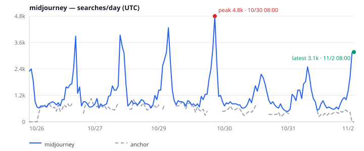
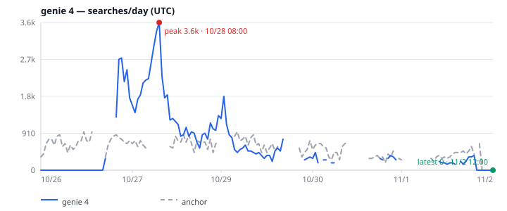
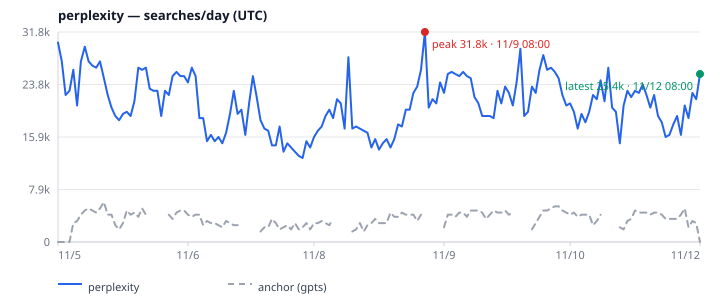
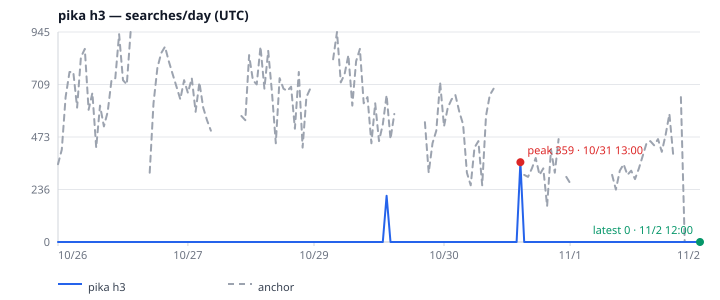

<p align="center">
  <picture>
    <source media="(prefers-color-scheme: dark)" srcset="docs/assets/logo-dark.svg">
    <source media="(prefers-color-scheme: light)" srcset="docs/assets/logo-light.svg">
    
  </picture>
</p>

<p align="center"><b>Search-interest signals for AI agents. One call in, stable JSON out.</b></p>

<p align="center">English | <a href="README.zh-CN.md">简体中文</a></p>

<p align="center"><a href="LICENSE"></a> <a href="https://nodejs.org">= 20"></a>   </p>

> [!WARNING]
> **Unofficial. Not affiliated with or endorsed by Google.** This project calls undocumented public Google Trends web endpoints that can change or fail without notice, and use may conflict with Google's Terms of Service. Use it for light, interactive analysis, not bulk scraping or an SLA.

`google-trends-for-agent` gives agents and humans a predictable way to ask how search interest is changing: a stable JSON envelope, calibrated searches/day estimates, charts, and explicit error codes instead of invented numbers.

<p align="center">
  
</p>
<p align="center"><sub>Real snapshot output, trimmed. The full envelope also includes the series, anchor points, per-query estimates, warnings, and metadata.</sub></p>

## Term gallery

<table>
  <tr><th align="center">Established terms</th><th align="center">New &amp; rising terms</th></tr>
  <tr>
    <td align="center"><br><sub><b>notion</b> · peak 45.9k · latest 30.3k searches/day</sub></td>
    <td align="center"><br><sub><b>gemini 4 carbon</b> · peak 18.0k · latest 7.7k searches/day</sub></td>
  </tr>
  <tr>
    <td align="center"><br><sub><b>midjourney</b> · peak 17.9k · latest 8.1k searches/day</sub></td>
    <td align="center"><br><sub><b>genie 4</b> · peak 786 · latest 0 searches/day</sub></td>
  </tr>
  <tr>
    <td align="center"><br><sub><b>perplexity</b> · peak 31.8k · latest 25.4k searches/day</sub></td>
    <td align="center"><br><sub><b>pika h3</b> · peak 786 · latest 0 searches/day</sub></td>
  </tr>
</table>
<p align="center"><sub>Estimates calibrated to the <code>gpts</code> anchor ≈ 3,500 searches/day; US, last 7 days, labels in UTC, fetched 2026-11-12 UTC.</sub></p>

## Install from GitHub

Requires Node.js 20+. Nothing is published to npm; `npx` builds the package from the git checkout.

```sh
# pinned release (recommended)
npx -y github:meka-im/google-trends-for-agent#v0.1.0 gtfa --help
npx -y github:meka-im/google-trends-for-agent#v0.1.0 gtfa doctor

# latest main
npx -y github:meka-im/google-trends-for-agent gtfa --help
```

For a global install, use the same git spec: `npm install -g github:meka-im/google-trends-for-agent#v0.1.0`. The package installs `gtfa` for the CLI and `gtfa-mcp` for the MCP server.

## Quick start

One snapshot, calibrated searches/day:

```sh
npx -y github:meka-im/google-trends-for-agent#v0.1.0 gtfa snapshot Sora --geo US --json --pretty
```

The MCP server runs over stdio by default. Point a client at the GitHub package (pin the tag for reproducibility):

```json
{
  "mcpServers": {
    "google-trends": {
      "command": "npx",
      "args": ["-y", "github:meka-im/google-trends-for-agent#v0.1.0", "gtfa-mcp"]
    }
  }
}
```

For a local **Streamable HTTP** endpoint (bound to `127.0.0.1`), add the optional flag:

```sh
npx -y github:meka-im/google-trends-for-agent#v0.1.0 gtfa-mcp --http --port 4321
# MCP endpoint: http://127.0.0.1:4321/mcp
```

## dsh plugin

```sh
dsh plugin --profile web add github:meka-im/google-trends-for-agent
# The first run prints pnpm's exact allowBuilds key and fails. Add that key under
# allowBuilds: in ~/.dsh/profiles/web/pnpm-workspace.yaml, then re-run the same command.
```

After install, open **dsh web → Plugins → Google Trends → gtfa → Configure**; if the bundle shows Off, switch it on. The bundle gives the agent four native tools — `trends_ask`, `trends_snapshot`, `trends_compare`, and `trends_now` — executed in-process by gtfa's core library. There is no MCP server, no `gtfa` CLI subprocess, and no Actor endpoint. A bundled `gtfa` skill tells the agent when to use each tool and how to report `no_data` / `blocked` honestly.

Configure egress (`local` or `apify`), the Apify token, default geo, proxy groups/country, baselines, and snapshot cache; changes apply live. The token entered in the UI is saved in plaintext in the profile's `cordis.patch.yml` (mode 0600), hidden in the UI and never logged or returned. Leave it blank and set `APIFY_TOKEN` (or `APIFY_PROXY_PASSWORD`) to keep it out of the profile.

`local` sends requests from the machine running dsh (`HTTPS_PROXY` is still honored). `apify` uses the Apify proxy without the Actor, fetches the proxy password once from the Apify API, and rotates the session on HTTP 429 or a Google challenge. Apify traffic is billed per GB from your Apify credits.

## Deploy to Apify

[](https://console.apify.com/actors/new)

The Actor runs this MCP server in **Standby mode** over **Streamable HTTP** and sends Google Trends requests through an **Apify Residential proxy in the US** by default. It is the remote path for agents that cannot run local processes or reach `localhost`.

From this repository:

```sh
apify push
```

Then give the client the Standby URL and an Apify API token:

```text
https://<user>--google-trends-for-agent.apify.actor/mcp
Authorization: Bearer APIFY_TOKEN
```

```json
{
  "mcpServers": {
    "google-trends": {
      "url": "https://<user>--google-trends-for-agent.apify.actor/mcp",
      "headers": { "Authorization": "Bearer APIFY_TOKEN" }
    }
  }
}
```

The hostname uses your Apify username with dots replaced by hyphens (for example, `meka.im` becomes `meka-im`, so `https://meka-im--google-trends-for-agent.apify.actor/mcp`). The Actor console also shows the exact Standby URL.

The Actor charges nothing. Apify Residential proxy traffic is billed per GB from your Apify credits at your plan's proxy rate; see the Apify Console for current pricing. Keep calls light: `trends_now` over many countries consumes more proxy traffic than a single `trends_ask`. Actor configuration and Store notes live in [`.actor/README.md`](.actor/README.md).

## MCP tools

| Tool | What it does |
| --- | --- |
| `trends_ask` | Interest, Popular/Rising queries, regions, optional verdict and diff. |
| `trends_snapshot` | Calibrated searches/day, anchor/traffic blocks, verdict, `chart7d` / `traffic7d`. |
| `trends_compare` | Relative 0–100 interest for 2–5 keywords on one shared scale. |
| `trends_now` | Trending Now by country, with rank, growth, categories, and links. |

Inputs, time windows, defaults, and envelope fields are in the [reference](docs/reference.md) and the [MCP field guide](docs/mcp-api.md).

## CLI

| Command | What it does |
| --- | --- |
| `gtfa ask <term>` | One term, with optional `--validate`, `--diff`, `--points`, and batch `--from`. |
| `gtfa snapshot <term>` | Calibrated traffic, related queries, verdict, and SVG charts. |
| `gtfa compare <kw> <kw> [...]` | Relative interest for 1–5 keywords (also `--query` mode). |
| `gtfa now` | Trending Now by country; `--hours` is the Now window. |
| `gtfa doctor` | Check Node, Google Trends reachability, proxy, and one `gpts` US 24h fetch; `--json` for machines. |

Full flags and examples: [reference](docs/reference.md#cli-surface).

## Anchors and how the numbers work

`snapshot` and `ask --validate` put the term and an anchor on one shared 0–100 scale, then calibrate with `traffic = round(score ÷ anchorLevel × dailySearches)`. The anchor is picked by time window:

| Window | Anchor | US baseline | Why this anchor |
| --- | --- | --- | --- |
| `now 1-H` · `now 4-H` · `now 1-d` | `sudoku` | **63,000/day**, ±50% | Searched around the clock (99.4% of 24h points nonzero), so short windows calibrate. `gpts` is too sparse there. |
| `now 7-d` and longer | `gpts` | **3,500/day**, ±50% | The reference ruler that every other baseline is derived from. |

**How 63,000 is derived:** on a 7-day shared scale `sudoku` averages 18.035 × `gpts`, so 18.035 × 3,500 ≈ 63,123. Going through `thesaurus` (7.341 × 3,500 ≈ 25,694, then × 2.441 ≈ 62,720) lands in the same place, so short and long windows use one ruler. The 3,500 baseline is back-derived from public keyword-tool volumes for sudoku, thesaurus, and calculator through measured Trends ratios — sources in [reference](docs/reference.md#calibration-and-the-anchor). Alternates: `thesaurus` ≈25,700/day; `chairs` ≈143,000/day.

- `--anchor` / MCP `anchor` forces one anchor for both windows. Every snapshot reports `anchor` (requested window) and `anchor7d` (the 7-day check) with the term and baseline used.
- Override or add baselines with a version 2 `baselines.json` (template: [examples/baselines.json](examples/baselines.json)):

```json
{ "version": 2,
  "anchors": [{ "term": "sudoku", "geo": "US", "dailySearches": 63000, "tolerance": 0.5 }],
  "windowAnchors": { "short": "sudoku", "long": "gpts" } }
```

```sh
GTFA_BASELINES=./baselines.json gtfa snapshot Sora --json   # gtfa-mcp reads it too
```

- Numeric traffic stays `null` unless the anchor has a non-gap point, `anchorLevel ≥ 1`, and at least 25% of non-gap points are nonzero.
- These are anchor-based **estimates**, not measured Google search volume. Failures stay explicit: `ok`, `status`, and `error.code` replace invented numbers.

## Docs

- [Reference: CLI, MCP envelopes, exit codes, calibration, limits](docs/reference.md)
- [MCP API field guide (中文)](docs/mcp-api.md)
- [Architecture](docs/assets/architecture.svg)
- [Changelog](CHANGELOG.md)
- [Baselines](examples/baselines.json)

## Development

Tests use local fixtures and mocked transports; they do not call Google.

```sh
npm install
npm test          # 280 tests
npm run typecheck
npm run build
npm run trends -- --help
```

Node.js 20+ is required. `npm run build` writes JavaScript and declarations to `dist/`. The library entrypoint (`src/index.ts`) exports the client, snapshot, calibration, chart, Trending Now, and time-zone APIs.

## License

MIT. See [LICENSE](LICENSE).
