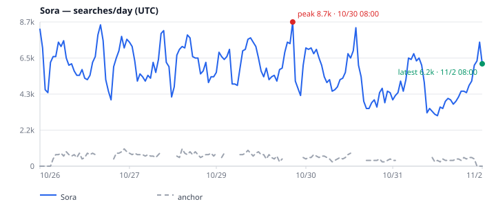
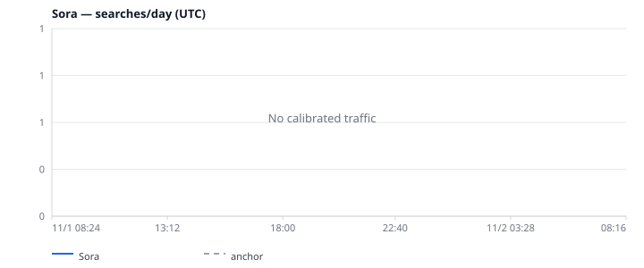

<p align="center">
  <picture>
    <source media="(prefers-color-scheme: dark)" srcset="docs/assets/logo-dark.svg">
    <source media="(prefers-color-scheme: light)" srcset="docs/assets/logo-light.svg">
    
  </picture>
</p>

<p align="center"><b>面向 AI Agent 的搜索兴趣信号。一次调用，输出稳定 JSON。</b></p>

<p align="center"><a href="README.md">English</a> | 简体中文</p>

<p align="center">
  <a href="LICENSE"></a>
  <a href="https://nodejs.org">= 20"></a>
  
  
  
</p>

> [!WARNING]
> **非官方项目，与 Google 无隶属关系，也未获其背书。** 本项目调用未公开的 Google Trends Web 接口，这些接口可能随时变更或失效，使用方式也可能与 Google 服务条款冲突。请仅用于轻量、交互式分析，不要用于批量抓取，也不要将其视为 SLA。

`google-trends-for-agent` 让 Agent 和人类以可预测的方式查询搜索兴趣变化。它返回稳定的 JSON 信封、由 `snapshot` 校准的每日搜索量估算、图表，以及明确的错误码，而不是编造数字。

## 安装

需要 Node.js 20+。

```sh
npm install github:meka-im/google-trends-for-agent
npx gtfa --help
```

或从本地检出构建：

```sh
git clone https://github.com/meka-im/google-trends-for-agent.git
cd google-trends-for-agent
npm install
npm run build
node dist/cli.js --help
```

`gtfa`、`google-trends-for-agent` 和 `trends-kit` 都是 CLI 别名。MCP 服务器以 `gtfa-mcp` / `google-trends-for-agent-mcp` 安装。

## 快照：校准后的每日搜索量

`snapshot` 将单个词与锚点放在同一个 0–100 共享尺度上比较，完成校准，返回相关查询和走势判断，并写出 SVG 图表。它始终包含 `now 7-d` 曲线，即 `chart7d` / `traffic7d`。

```sh
npx gtfa snapshot Sora --geo US --pretty --json
# 可选：内嵌 SVG 文本、选择图表时区，或强制实时抓取
npx gtfa snapshot Sora --geo US --svg --tz Asia/Shanghai --fresh --json
```

一次真实的 7 天运行（2026-11-02 UTC）成功校准：**峰值 8,684（8.7k），最新 6,166（6.2k）次搜索/天**，平均 5,782。

<p align="center">
  
</p>
<p align="center"><sub>真实的 <code>Sora --geo US --time "now 7-d"</code> 输出，标签使用 UTC。7 天窗口有足够密集的 <code>gpts</code> 锚点，因此可以校准。</sub></p>

同一个词在 **24 小时**窗口下返回 **无校准流量**：

<p align="center">
  
</p>
<p align="center"><sub>真实的 24 小时图表。180 个非缺口 <code>gpts</code> 锚点中只有 27 个非零（15%），低于 25% 的可靠性门槛，因此 <code>traffic.*</code> 为 <code>null</code>，图表显示“No calibrated traffic”。这是预期行为，不是渲染错误；请改用更密集的窗口或锚点。</sub></p>

<p align="center">
  
</p>
<p align="center"><sub>真实快照输出，已裁剪。完整信封还包含序列、锚点、逐查询估算、警告和元数据。</sub></p>

<p align="center">
  
</p>

## MCP 工具

stdio 服务器只暴露四个工具，没有别名：

| 工具 | 输入 | 返回 |
| --- | --- | --- |
| `trends_ask` | `term`（必填）；`geo`（`US`）；`time`（`now 1-d`）；`fresh`（`false`）；`validate`（`false`）；`points`（`false`） | 兴趣、热门/上升相关查询、地区、可选 verdict，以及与上一个已保存快照的 diff。`points: true` 会包含完整序列。 |
| `trends_snapshot` | `term`（必填）；`geo`（`US`）；`time`（`now 1-d`）；`anchor`（`gpts`）；`fresh`（`false`）；`svg`（`false`）；`tz`（`GTFA_TZ`，然后 `UTC`） | 校准后的每日搜索量、锚点与流量块、序列、verdict、相关查询、`chart`，以及始终存在的 `chart7d` / `traffic7d`。 |
| `trends_compare` | `keywords`（2–5 个，必填）；`geo`（`US`）；`time`（`now 1-d`） | 每个关键词在同一共享尺度上的相对 0–100 兴趣，含缺口感知的最新值/峰值。重复关键词返回 `INVALID_INPUT`。 |
| `trends_now` | `geos`（数组、`"default"` 或 `"all"`；默认 `"default"` = 30 个国家/地区）；`hours`（`4`、`24`、`48` 或 `168`；默认 `24`）；`limit`（整数 ≥ 0；默认 `10`） | 每个国家/地区的 Trending Now 条目，含排名、流量区间、增长、分类、相关查询和链接。 |

`time` 取值为 `now 1-H`、`now 4-H`、`now 1-d`、`now 7-d`、`today 1-m`、`today 3-m`、`today 12-m`、`today 5-y`、`all`。前三个工具默认美国、`now 1-d`、网页搜索、分类 0。`fresh: false` 会复用 360 分钟内保存的快照；`fresh: true` 强制实时抓取。

通过 stdio 启动服务器：

```sh
npx gtfa-mcp
```

客户端配置示例：

```json
{
  "mcpServers": {
    "google-trends": { "command": "gtfa-mcp" }
  }
}
```

常用环境变量：`GTFA_SNAPSHOT_DIR` 和 `GTFA_CHART_DIR` 可迁移 `.gtfa/snapshots` 与 `.gtfa/charts` 存储目录（适合只读工作目录），`GTFA_TZ` 设置默认图表时区，`HTTPS_PROXY` 选择 HTTP 代理。MCP 信封的中文字段指南见 [docs/mcp-api.md](docs/mcp-api.md)。

## CLI

| 命令 | 选项 | 用途 |
| --- | --- | --- |
| `gtfa ask <term>` | `--validate`、`--from FILE\|-`、`--anchor TERM`、`--no-anchor`、`--trending`、`--diff`、`--points`、`--fresh`、`--no-cache`、`--refresh always\|never\|if-stale`、`--max-age MIN`、`--geo`、`--time`、`--category`、`--property`、`--store DIR`、`--json`、`--help` | 单个词：兴趣、热门/上升查询、地区，可选 verdict 和 diff。 |
| `gtfa snapshot <term>` | `--geo`、`--time`、`--anchor`、`--fresh`、`--no-cache`、`--max-age MIN`、`--store DIR`、`--chart-dir DIR`、`--tz IANA`、`--svg`、`--json`、`--pretty`、`--help` | 校准后的每日搜索量、流量序列、verdict、图表和图表路径。 |
| `gtfa compare <kw> <kw> [...]` | `--url URL`（可重复）、`--geo`、`--time`、`--start YYYY-MM-DD`、`--end YYYY-MM-DD`、`--types LIST`、`--format json\|csv`、`--json`、`--timeout MS`、`--retries N`、`--min-interval MS`、`--pretty`、`--help`、`--version` | 1–5 个关键词的相对兴趣。默认的 `--query` 模式与之相同。 |
| `gtfa now` | `--geo US,SG,JP`、`--all-geos`、`--default-geos`、`--list-geos`、`--hours 4\|24\|48\|168`、`--min-volume N`、`--category 18,17`、`--limit N`、`--lang en`、`--format json\|csv`、`--json`、`--pretty`、`--timeout MS`、`--min-interval MS`、`--help` | 按国家/地区获取 Trending Now。`--hours` 是 Trending Now 窗口，不是 Explore 的 `--time` 范围。 |

`--types` 接受 `interestOverTime`、`interestByCity`、`interestByMetro`、`interestBySubregion`、`relatedQueries` 或 `relatedTopics`。`--start` 与 `--end` 必须同时使用；不要将 Explore URL 与 `--query` 混用。除命令另有说明外，默认值为美国、`now 1-d`、网页、分类 0。过滤器还会读取 `gtfa.config.json`、`GTFA_GEO` 和 `GTFA_TIME`；图表时区优先级为显式 `--tz` / `tz`，然后 `GTFA_TZ`，最后 `UTC`。

```sh
npx gtfa ask "nano banana" --validate --diff --json
new-term-radar leads --json | npx gtfa ask --validate --from - --json
npx gtfa compare coffee tea --geo US --time "today 3-m" --pretty
npx gtfa --query coffee --query tea --geo US --json
npx gtfa now --geo SG --hours 24 --limit 20 --pretty
npx gtfa now --list-geos
npx gtfa help snapshot
```

`--json` 用于选择 Agent 信封。不加时，`snapshot` 输出人类可读的摘要行；`ask --validate` 输出紧凑表格（`--diff` 会隐含 JSON）。`compare`/默认模式默认输出 JSON，但只有加 `--json` 才是 Agent 信封；`now` 默认输出原始 JSON，加 `--json` 才是信封。交互式 TTY 下帮助文本为纯文本；管道或加 `--json` 时输出 JSON。诊断信息写入 stderr。

## 输出契约与错误码

MCP 结果和 CLI 的 Agent 信封（`ask`、`snapshot --json`，以及 compare/默认模式加 `--json`）共享外层字段 `ok`、`schemaVersion`（当前为 `1`）、`status`、工具专属正文、可选 `error` 和 `meta`。`trends_now` 可能返回 `ok: true` 的 partial 结果，同时仍包含第一个按国家/地区记录的 `error`。对 `ask`/`snapshot` 而言，成功状态为 `ok`、`no_data` 或 `partial`；`blocked` 和 `error` 会设置 `ok: false` 并包含 `error.code`。`trends_compare` 和 `trends_now` 使用 `ok`、`partial` 和 `error`；schema 拒绝可设置 `ok: false` 并带 `error.code`。MCP 在 `ok: false` 时还会设置 `isError: true`。不带 `--json` 时，compare/默认模式输出下面所述的底层响应。

各工具正文：

- `trends_ask`：`term`、`summary`、`filter`、`interest`、`tables`、`regions`、可选 `verdict`、`diff`、可选 `diffReason`、`meta`。
- `trends_snapshot`：`term`、`summary`、`filter`、`anchor`、`traffic`、`series`、`chart`、`chart7d`、`traffic7d`、`tables`、`verdict`、`meta`。
- `trends_compare`：`filter`、`summary`、`series`、`meta`。
- `trends_now`：`hours`、`geos`、`summary`、`byGeo`、`meta`。

错误对象为 `{ "code": string, "message": string, "retryAfterSec"?: number }`。底层 `queryTrends()` API 则返回 `{ status, input, data?, error?, meta }`。

| 错误码 / 结果 | CLI 退出码 | 含义 |
| --- | --- | --- |
| 成功 | `0` | 完全成功；快照/ask 信封中的 `no_data` 也以 0 退出。 |
| `partial` | `ask`、`compare`/默认模式和 `now` 为 `2`；`snapshot` 为 `0` | 部分区块或国家/地区成功，其余失败。成功的 snapshot partial 仍以 0 退出。 |
| `BLOCKED` | `3` | 上游出现挑战 / 异常流量。停止并报告。 |
| `RATE_LIMITED` | `3` | 上游限流。按 `retryAfterSec` 等待后再做有限重试。 |
| `INVALID_INPUT` | `4` | 参数或 CLI 用法无效。 |
| `INVALID_COMBINATION` | `4` | 选项组合不兼容，例如同时使用 `timeRange` 和日期。 |
| `REQUEST_TOO_LARGE` | `1` | 请求超过支持的大小。 |
| `TRENDS_TIMEOUT` | `1` | 上游请求超时。 |
| `TRENDS_PROTOCOL_CHANGED` | `1` | 上游响应不符合预期协议。 |
| `TRENDS_TEMPORARILY_UNAVAILABLE` | `1` | 上游服务器故障。 |
| `NETWORK_ERROR` | `1` | 传输连接失败。 |

批量请求的退出码优先级为：blocked/rate-limited、无效输入、部分成功、其他错误。

## 校准与锚点

`snapshot` 和 `ask --validate` 使用同一套缺口感知校准：

```text
traffic = round(score ÷ anchorLevel × dailySearches)
```

`anchorLevel` 是同一次共享尺度比较中锚点非缺口点的均值。内置基线位于 [examples/baselines.json](examples/baselines.json)：

| 锚点 | 地区 | 每日搜索量 | 容差 |
| --- | --- | --- | --- |
| `gpts` | `US` | **550/天**（约 16.5k/月） | ±50% |

`traffic.low` / `traffic.high` 会在平均值上应用该容差。若没有匹配地区 + 锚点的基线，或锚点未通过可靠性门槛，数值流量为 `null`：

- 至少有一个非缺口锚点；
- Trends 整数尺度上的缺口感知 `anchorLevel ≥ 1`；
- 非缺口锚点中至少 25% 非零。

上面的 Sora 24 小时运行未通过第三条（`27/180` 非零，15%），尽管 `anchorLevel` 为 `2.72`。因此 `anchor.ratio` 和数值 `traffic` 字段为 `null`，`anchor.note` 会说明原因。verdict 仍会使用相关查询和序列形态信号。7 天窗口更密集，可以正常校准。

这些数字是**基于锚点的估算**，不是 Google 实测搜索量。当请求窗口不是 `now 7-d` 时，`traffic7d` 和 `chart7d` 来自另一次 7 天抓取，可作为第二重检查；当请求本身就是 `now 7-d` 时，它们复用主快照和主图表，因此并不独立。

## 速率限制

- 上游请求默认间隔：CLI/库的 Explore 请求为 **1000 ms**；Trending Now（`now` / `trends_now`）和所有 MCP 请求为 **1500 ms**。
- `BLOCKED` 和 `RATE_LIMITED` 会立即返回，不自动重试。它们会触发自适应退避，上限 60 秒（下限 1 秒）；成功后退避惩罚减半。
- 瞬时 `TRENDS_TIMEOUT`、`TRENDS_TEMPORARILY_UNAVAILABLE` 和 `NETWORK_ERROR` 最多重试 `maxRetries` 次（默认 `1`，最大 `2`）。默认超时 8000 ms；有效范围 1000–60000 ms。
- 批量和 `trends_now` 默认在第一次 block 后停止；后续条目会报告为 blocked/skipped。
- 保持小规模工作负载。本项目不适合批量抓取或持续轮询；重试或代理也不保证访问成功。

## 开发

测试使用本地 fixture 和 mock transport，不会调用 Google。

```sh
npm install
npm test          # 194 个测试
npm run typecheck
npm run build
npm run trends -- --help
```

需要 Node.js 20+。`npm run build` 会将 JavaScript 和类型声明写入 `dist/`。库入口（`src/index.ts`）导出客户端、快照、校准、图表、Trending Now 和时区 API。

## 许可证

MIT。见 [LICENSE](LICENSE)。
