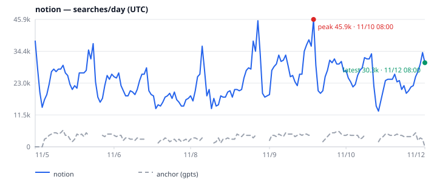

<p align="center">
  <picture>
    <source media="(prefers-color-scheme: dark)" srcset="docs/assets/logo-dark.svg">
    <source media="(prefers-color-scheme: light)" srcset="docs/assets/logo-light.svg">
    
  </picture>
</p>

<p align="center"><b>面向 AI Agent 的搜索兴趣信号。一次调用，输出稳定 JSON。</b></p>

<p align="center"><a href="README.md">English</a> | 简体中文</p>

<p align="center"><a href="https://apify.com/meka.im/google-trends-for-agent"></a> <a href="LICENSE"></a> <a href="https://nodejs.org">= 20"></a>  </p>

<p align="center"><a href="https://apify.com/meka.im/google-trends-for-agent"><picture><source media="(prefers-color-scheme: dark)" srcset="docs/assets/store-button-zh-dark.png"></picture></a></p>

> [!WARNING]
> **非官方项目，与 Google 无隶属关系，也未获其背书。** 本项目调用未公开的 Google Trends Web 接口，这些接口可能随时变更或失效，使用方式也可能与 Google 服务条款冲突。请仅用于轻量、交互式分析，不要用于批量抓取，也不要将其视为 SLA。

`google-trends-for-agent` 让 Agent 和人类以可预测的方式查询搜索兴趣变化：稳定的 JSON 信封、校准后的每日搜索量估算、图表，以及明确的错误码，而不是编造数字。

<p align="center">
  
</p>
<p align="center"><sub>真实快照输出，已裁剪。完整信封还包含序列、主窗口与近 7 天流量块、相关查询上下文、警告和元数据。</sub></p>

## 选择路线

**Muse、GrokBot、Dots 统一优先使用 Apify 按需运行**，可选公共 Actor 或自己部署的
Actor。支持远程 MCP 时接入官方托管入口；否则使用客户端已有的 Apify 连接器/API。
详见[客户端接入指南](docs/clients.md)。本机直连继续用于开发或用户明确选择的场景。

| 路线 | 执行位置 | 运行方式 |
| --- | --- | --- |
| 公共 Actor | 你的 Apify 账号 | 有查询才启动，完成即退出，无需部署 |
| 自己的 Actor | 你的 Apify 账号 | 部署一次，随后按次运行 |
| 本机直连 | 本机 | CLI、stdio MCP 或 dsh 原生工具 |

<a id="deploy-it-yourself"></a>

### 自行部署

Fork 仓库，在 Apify Console 用 Link Git repository 构建，或运行 `apify push`。保持 Server / Standby 关闭。dsh 中选择“我自己的 Actor”，登录 Apify，再选择已构建的 Actor。

已从官方 main 部署的 Actor，可在 dsh 点击**更新选中的 Actor**。构建完成后，**测试连接**分别显示关键词取数与 Actor/插件的实际版本。自定义或固定版本源码请在 Apify Console 更新。详见[发布与验收清单](docs/releasing.md)。

### 远程 MCP

Muse、GrokBot、Dots 支持远程 MCP 时，使用 Apify 官方托管入口，在客户端内完成 OAuth 登录：

```json
{
  "mcpServers": {
    "google-trends": {
      "url": "https://mcp.apify.com?tools=meka.im/google-trends-for-agent"
    }
  }
}
```

使用自建 Actor 时，把 `tools=` 后的 `meka.im/google-trends-for-agent` 替换为自己账号的
`<username>/<actor-name>`；登录账号需要有该 Actor 的访问权限。

该入口将本项目暴露为 Actor 工具，按次启动运行，并提供读取 Dataset、读取 key-value store 和停止运行的工具。它不承诺四个 `trends_*` 同名工具；本机 MCP 和 dsh 原生插件提供四个 `trends_*` 工具。通过官方入口调用普通 `tool` / `terms` 输入后，用返回的 Dataset id 读取结果。

Apify OAuth 的 `full_api_access` 是完整账号 API 权限。没有 MCP OAuth 的客户端可通过安全凭据配置 Bearer header。费用与边界见 [Actor 参考](.actor/README.md) 和 [Actor costs](docs/reference.md#actor-costs)。

## 安装与快速开始

CLI/MCP 需要 Node.js 20+。项目不发布到 npm；首次运行时 `npx` 会从 GitHub 检出并构建。下方命令跟随仓库的 `main` 分支。

```sh
npx -y -p github:meka-im/google-trends-for-agent gtfa snapshot Sora --geo US --json --pretty
```

GitHub 依赖的构建已用 npm 11.19.1 验证。npm 10.9.4 可能先成功构建该依赖，随后在 npm 打包阶段因 `GitFetcher` 缺少 Arborist 依赖而报错。遇到该报错时，请使用下方的 clone → `npm ci` → pack 持久安装流程，或升级 npm。CLI 和安装后的包仍要求 Node.js 20+。

零安装的 `npx` 路径会在首次使用时从 git 构建，耗时取决于网络和机器。频繁使用建议持久安装或运行 MCP 服务器。

持久安装（先克隆，因为 npm 全局安装 git 依赖时，`prepare` 阶段可能缺少构建所需的 devDependencies）。用打包后的 tarball 安装，之后可以删除 clone 目录：

```sh
git clone https://github.com/meka-im/google-trends-for-agent.git
cd google-trends-for-agent
npm ci
npm install -g "$(npm pack | tail -1)"
```

clone 默认跟随仓库的 `main` 分支。如果审查流程需要不可变源码版本，请自行加上 commit pin，不要依赖移动的分支。

打包后的 tarball 会内置经审计的 `apify` 依赖树，避免 consumer 重新解析较旧的 Apify 漏洞传递依赖。根 npm `overrides` 不会传播给 consumer，因此内置依赖树是 consumer 防护的一部分。根包还显式将 `@crawlee/core` 的 `minimatch` 覆盖为 `^11.0.1`（lock 为 `11.0.8`）；Crawlee 声明的是 `^9`，因此 consumer 的 `npm ls` 可能显示范围警告，但这是有意设置的安全 override。审计同时覆盖根依赖树和打包产物在干净 consumer 中的安装；内置依赖会使包体积明显增大。

CLI 命令是 `gtfa`，本地 MCP 服务器由 `gtfa-mcp` 启动。下面的 stdio 配置使用运行机器的
网络；Muse、GrokBot、Dots 优先按[Apify 接入指南](docs/clients.md)配置：

```json
{
  "mcpServers": { "google-trends": { "command": "npx", "args": ["-y", "-p", "github:meka-im/google-trends-for-agent", "gtfa-mcp"] } }
}
```

持久安装后可直接使用下面的配置（或 `gtfa-mcp` 的绝对路径），避免每次启动都由 npx 解析 GitHub 包：

```json
{
  "mcpServers": { "google-trends": { "command": "gtfa-mcp", "args": [] } }
}
```

本地 **Streamable HTTP** 端点（仅绑定 `127.0.0.1`）：

```sh
npx -y -p github:meka-im/google-trends-for-agent gtfa-mcp --http --port 4321   # http://127.0.0.1:4321/mcp
```

检查包下载和数据抓取两段连通性：

```sh
curl -I https://github.com
curl -I https://trends.google.com
```

若 `npx …` 退出 128 且 stdout/stderr 为空，说明 gtfa 启动前 GitHub 包获取失败；查看 npm debug 日志（通常在 `~/.npm/_logs/`）。**MCP 无法启动**表现为 npx/git 错误、握手前 EOF；**MCP 已启动但工具取数失败**则握手和 `tools/list` 成功，工具返回 `NETWORK_ERROR`、`RATE_LIMITED` 等上游错误。后者可用 `gtfa doctor --json` 排查。

## dsh 插件

前置条件：dsh 需要 **Node >=24.9**，并确保 **pnpm >=10** 在 PATH 中（`allowBuilds` 需要 pnpm 10；测试版本为 10.34.6）。用 `npm i -g @deepseek-ai/dsh` 安装 dsh，用 `npm i -g pnpm@10` 安装 pnpm。仅使用 gtfa CLI/MCP 时仍只需 Node 20+（`engines.node: >=20`）。PATH 中没有 pnpm 时，插件安装会报 `spawn pnpm ENOENT` / `pnpm was not found`。

```sh
dsh plugin --profile web add github:meka-im/google-trends-for-agent
```

安装或升级插件后，请完全退出并重新打开 dsh，以加载插件后端。插件设置保存后立即生效。

首次运行通常会打印 key 并失败；pnpm store 已缓存构建时可能直接成功。将下方代码块以 pnpm 打印的完整 key（以 commit hash 结尾）**追加**到 dsh 已生成的 `$DSH_HOME/profiles/web/pnpm-workspace.yaml`（`DSH_HOME` 默认为 `~/.dsh`），保留已有键，不要覆盖文件，然后重跑。使用其他 profile 时，同时替换命令和路径中的 `web`：

```yaml
allowBuilds:
  "google-trends-for-agent@https://codeload.github.com/meka-im/google-trends-for-agent/tar.gz/<commit>": true
```

pnpm 的提示框可能把 key 折成多行，请从本模板复制，只需改 commit hash。

pnpm 的报错建议使用 `onlyBuiltDependencies:` 列表；dsh profile 应使用带 `: true` 的 `allowBuilds:` map（在 `allowBuilds` 下写列表会失败）。main 更新后 key 会变化，需要重新添加。

插件安装后默认启用，提供四个原生工具和 `gtfa` skill。在 dsh 0.2.2-rc.1 中，打开 **dsh web → Plugins → Google Trends** 已安装插件卡片，在详情页 **Components** 下点击 **Google Trends / gtfa** 行进入设置页。在 **Connection（连接方式）** 区块选择 **本机直连**、**公共 Actor** 或 **我自己的 Actor**，再点 **Save（保存）** 应用 egress；登录本身不需要 Save。Host 提供 credentials service 时，两条 Actor 路线都提供 **Sign in with Apify（登录 Apify）**：页面显示 Apify 官方授权链接和 user code；pending 时每 2 秒查询一次状态并遵守 Apify 的 polling interval（包括 `slow_down`），关闭页面暂停、重新打开继续，过期后重新发起。Apify 当前的 device OAuth scope 只有 `full_api_access`——这是完整 Apify API 访问权限，不是仅限本 Actor 或本工具的权限。

每次操作都会重新解析凭据：优先使用已存储的 OAuth session；只有在没有存储 session 时才使用已保存 config token，再回退到 `APIFY_TOKEN`。已存储的 session 若过期或损坏且无法 refresh，必须重新登录，不能静默回退或当作成功。OAuth 凭据不会进入浏览器可见状态，也不会进入模型可见的 tool input/output；Host 内部代码通过 credentials service 解析后调用 Apify。Host 没有该服务时，OAuth 不可用，但本机 egress、手动 token 和 `APIFY_TOKEN` 仍可使用。对 dsh device flow，当前 access token 是长效 token，不签发 refresh token；若 Apify 未来返回标准过期/刷新响应，插件可兼容处理。

设置页采用三张出口卡片，下方集中显示 OAuth 状态和用量；展开**用量详情**可查看计费周期及代理用量。**高级**内分为**校准基线**、**手动 Token**（仅 Actor 出口）和**文件与图表**。**保存更改**与**还原**悬浮于页面底部；**测试连接**直接使用当前连接，包括尚未保存的 Actor 和手动 Token，不会保存设置。退出登录位于连接检查旁的账号菜单内。界面跟随 Host 的深浅主题，并适配窄屏。

持久化交给 dsh credentials service/provider-managed store，与 profile 分离；后端位置、记录键和 schema 可以不同。当前本地 file-backed provider 在适用时使用 owner-only `0700` 目录与 `0600` 文件权限；它不是 OS Keychain，也不是加密存储，不能阻止同一 OS 用户下的其他进程读取。手动 token 位于**高级 / 备用**区域，仍会明文写入 `cordis.patch.yml`（mode `0600`），UI 中隐藏，不会记录，也不会进入浏览器可见状态或模型可见的 tool input/output。**Cancel（取消）** 只取消 pending flow。**Sign out（注销）** 删除已存储的 OAuth session，但按 provider 后端保留可复用的 client registration；它**不会撤销 Apify 云端授权**，如需撤销请到 Apify Console。路由和生命周期细节见 [dsh 插件参考](docs/reference.md#dsh-plugin)。

从 dsh 侧边栏（或「更多」）打开 **Google Trends**，可使用「总览、查询、记录」三页。单词快照和多词对比共用九种时间范围，从过去 1 小时到全部时间。「插件设置」打开已有的已安装插件页面；对话仍使用原来的四个原生工具。

查询统一输入 1–5 个关键词，用逗号分隔并自动选择工具。多词使用同一批数据、一次按需 Actor 运行，有空位时把校准锚点一并带上。当前适配器使用 Classic Explore 的五项对比接口；Google 的[新版 Explore 页面支持更多对比组](https://support.google.com/trends/answer/4359550?hl=en)。5 个关键词占满当前适配器的本批对比项，此时需其中已有本地区的已知锚点，才能同批估算搜索量；没有可用校准时如实留空。页面显示实际运行阶段和已用时间；切到其他 dsh 页面后，草稿、进行中的请求和结果都会保留。点击「取消」可停止请求；关闭或刷新浏览器、卸载插件会取消请求。

Host 将最近 1,000 次手动和 Agent 调用（包含失败及结果副本）保存在 `<snapshotDir>/.query-history`。回看和刷新记录不会重新查询。可确认清理单条、所选或全部记录，统计随之变化；查询缓存、Apify 运行和账单独立保留。Actor 费用只展示关联运行实际返回的金额，缺失时保持未知。打开页面不会启动 Actor，也不会在后台持续取数。

相对 `snapshotDir` / `chartDir` 路径以启动 `dsh web` 的目录（cwd）为基准；图表默认写入 `<cwd>/.gtfa/charts/`。

**测试连接**会先检查网络和认证，再合并查询 ChatGPT、Gemini、weather（美国，近 24 小时），逐个显示数据点数量，并支持取消。Actor 模式在基础检查通过后启动一次按量计费的运行，完成即退出；遇到验证码或限流立即停止，不自动重试。

## 词条图库

<table>
  <tr><th align="center">已成熟词</th><th align="center">新词与上升词</th></tr>
  <tr>
    <td align="center"><br><sub><b>notion</b> · 峰值 45.9k · 最新 30.3k 次搜索/天</sub></td><td align="center"><br><sub><b>gemini 4 carbon</b> · 峰值 18.0k · 最新 7.7k 次搜索/天</sub></td>
  </tr>
</table>
<p align="center"><sub>更多图表：<a href="docs/assets/traffic-midjourney-us-7d.svg">midjourney</a> · <a href="docs/assets/traffic-genie-4-us-7d.svg">genie 4</a> · <a href="docs/assets/traffic-perplexity-us-7d.svg">perplexity</a> · <a href="docs/assets/traffic-pika-h3-us-7d.svg">pika h3</a>。估算以 <code>gpts</code> 锚点 ≈ 3,500 次搜索/天校准；美国、近 7 天，标签使用 UTC，抓取于 2026-11-12 UTC。</sub></p>

## MCP 工具

| 工具 | 用途 |
| --- | --- |
| `trends_ask` | 兴趣、热门/上升查询、地区，可选 verdict 和 diff。 |
| `trends_snapshot` | 校准后的每日搜索量、锚点/流量块、verdict、`chart7d` / `traffic7d`。 |
| `trends_compare` | 1–5 个不同关键词在同一共享尺度上的相对 0–100 兴趣。 |
| `trends_now` | 按国家/地区获取 Trending Now，含排名、增长、分类和链接。 |

输入、时间窗、默认值和信封字段见[参考文档](docs/reference.md)和 [MCP 字段指南](docs/mcp-api.md)。

## CLI

| 命令 | 用途 |
| --- | --- |
| `gtfa ask <term>` | 单个词，可选 `--validate`、`--diff`、`--points`、批量 `--from`，并支持单次请求 `--timeout MS` 和 `--pretty`。 |
| `gtfa snapshot <term>` | 校准流量、相关查询、verdict、SVG 图表，并支持单次请求 `--timeout MS`。 |
| `gtfa compare <kw> [<kw> ...]` | 1–5 个不同关键词的相对兴趣（也支持 `--query` 模式）。 |
| `gtfa now --geo US` | 按国家/地区获取 Trending Now；`--hours` 是 Now 窗口。 |
| `gtfa doctor` | 检查 Node、Google Trends 可达性、代理，并执行一次 `gpts` 美国 24 小时抓取。`--timeout MS` 限制每项网络检查；遇到 challenge 或 HTTP 429 时不再执行 live fetch。`--json` 供机器读取。 |

完整选项和示例见[参考文档](docs/reference.md#cli-surface)。

`gtfa ask --pretty` 会缩进普通 ask、validation batch、diff 和错误 JSON，而 `ask --validate` 未传 `--json` 时仍输出表格；`--timeout MS` 作用于每个 Explore 请求，不是整次调用的总时限，慢速 VM 可显式提高到 60000。

## 数字如何计算

`snapshot` 和 `ask --validate` 把词条与锚点放在同一个 0–100 尺度上，再按 `traffic = round(score ÷ anchorLevel × dailySearches)` 计算。这些是基于锚点的估算，不是 Google 实测搜索量；没有可用校准或锚点未通过可靠性门槛时，流量为 `null`。

标定基线（包括 version 2 文件和用户提供的锚点行）只适用于 **Web、category 0**。CLI 使用其他 property 或分类过滤时仍可返回相对兴趣，`traffic` / `traffic7d` 对象继续存在，但其中的每日搜索量字段为 `null` 并附带说明；version 2 格式没有扩展。只有 Snapshot 的 Popular/Rising 行保留 `estDaily` 以兼容公开 schema，且它始终为 `null`：相关查询榜单与主词并不共享同一兴趣标尺。Ask 的相关词表不包含 `estDaily`。

Snapshot 的近 7 天工作按顺序执行。主窗口不是 `now 7-d` 时，主尝试结束后，只要结果不是 `BLOCKED` / `RATE_LIMITED`，就尝试一次单独的 7 天请求；普通 `NETWORK_ERROR` 等错误本身不会阻止这次尝试。请求被跳过时返回空图表、null 流量和基线元数据，同时附带 warning。调用方取消或整体 deadline 会传播到整个 snapshot，不会被转换成上述正常兜底字段。

| 窗口 | 锚点 | 美国基线 |
| --- | --- | --- |
| `now 1-H` · `now 4-H` · `now 1-d` | `sudoku` | **63,000/天**，±50% |
| `now 7-d`、`today 1-m`、`today 3-m`、`today 12-m`、`today 5-y`、`all` | `gpts` | **3,500/天**，±50% |

加拿大、英国、澳大利亚、德国、法国、日本、印度和全球现有各自的自动基准（±75% 假设区间）。[地区数值、来源与验证](docs/baselines.md)列出统计期及限制；未知地区或稀疏数据仍返回 null。

推导过程、锚点覆盖、基线文件和 null 流量规则见[校准与锚点](docs/reference.md#calibration-and-the-anchor)。

## 文档

[客户端接入](docs/clients.md) · [参考文档](docs/reference.md) · [MCP 字段指南（中文）](docs/mcp-api.md) · [架构图](docs/assets/architecture.svg) · [更新日志](CHANGELOG.md) · [基线](examples/baselines.json)

## 开发

测试使用本地 fixture 和 mock transport，不会调用 Google。

CI、设置页交互和真实 Host 版本验证见[自动化检查与 dsh 兼容测试](docs/testing.md)。

```sh
npm install
npm test
npm run typecheck
npm run build
npm run trends -- --help
```

## 许可证

MIT。见 [LICENSE](LICENSE)。
