# DeepSeek Harness (dsh) Setup Guide

[← All client guides](../clients.md)

DeepSeek Harness (`dsh`) runs `google-trends-for-agent` as a **native in-process plugin** with four direct tools (`trends_ask`, `trends_snapshot`, `trends_compare`, `trends_now`), a `gtfa` skill, a visual **Query / History** sidebar panel, and built-in **Apify device OAuth**.

## Prerequisites

- **Node.js >= 24.9** and **pnpm >= 10** on `PATH` (`allowBuilds` requires pnpm 10).
- Install dsh: `npm i -g @deepseek-ai/dsh` and pnpm: `npm i -g pnpm@10`.

## Install

<p align="center">
  
</p>

- **DeepSeek Harness Desktop (macOS):** open **Plugins → + Install plugin**, enter **`google-trends-for-agent`** directly (do not paste a full `npmjs.com` web URL), and click **Install**—no manual `allowBuilds` editing required.
- **dsh CLI (`dsh web`):**

```sh
dsh plugin --profile web add google-trends-for-agent
```

After installing or upgrading, **fully quit and reopen dsh** so the backend loads the new build.

<details>
<summary>Alternative: installing unreleased commits from GitHub <code>main</code></summary>

```sh
dsh plugin --profile web add github:meka-im/google-trends-for-agent
```

The first GitHub install usually prints a build-approval key and exits. Append that exact key (ending in the commit hash) as an `allowBuilds:` map to `$DSH_HOME/profiles/web/pnpm-workspace.yaml` (`DSH_HOME` defaults to `~/.dsh`), keeping all existing keys, then re-run:

```yaml
allowBuilds:
  "google-trends-for-agent@https://codeload.github.com/meka-im/google-trends-for-agent/tar.gz/<commit>": true
```

</details>

## Configure egress & Apify OAuth

1. Open **dsh → Plugins → Google Trends** (or click **Plugin settings** directly in the **Google Trends** sidebar panel).
2. Choose an **Egress** mode and click **Save**:
   - **Local (this machine)**: direct from your machine (honors `HTTPS_PROXY` / `HTTP_PROXY`).
   - **Public Actor** *(recommended if local IP is rate-limited)*: runs `meka.im/google-trends-for-agent` on demand with Apify residential proxy.
   - **My own Actor**: deploy or select your own `google-trends-for-agent` Actor right from the settings page.
3. For either Actor mode, click **Sign in with Apify** to complete RFC 8628 device OAuth (`full_api_access` scope; login needs no Save). A manual token fallback is available under **Advanced → Manual Token** (or `APIFY_TOKEN` env var).
4. Click **Test connection** to verify both network reachability and live 3-keyword data (`ChatGPT`, `Gemini`, `weather`) plus the actual Actor/plugin versions.

## MEKA calibration baselines & dashboard

- The plugin ships with the **MEKA v1 baseline catalog** (59 Google Ads Keyword Planner anchors across 7 regions, `2026-11-19`), syncs once automatically on first boot, and reuses the cached file thereafter. Refresh manually any time under **Advanced → Calibration baselines → Sync now**.
- Open **Google Trends** in the dsh sidebar for **Query** (defaults to `now 7-d`, supports 1–5 comma-separated terms with multi-tier calibration) and **History** (retains the latest 1,000 manual and Agent runs locally under `<snapshotDir>/.query-history`).

## Quick verification prompt

```text
Use trends_snapshot to check "Sora" in US over the default window, then use trends_compare with calibrate: true for ["ChatGPT", "Claude", "Gemini"] in US. Report the window, anchor(s), estimated searches/day, and fetchedAt.
```
